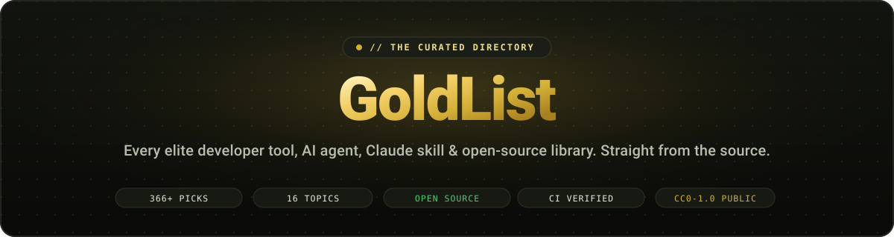
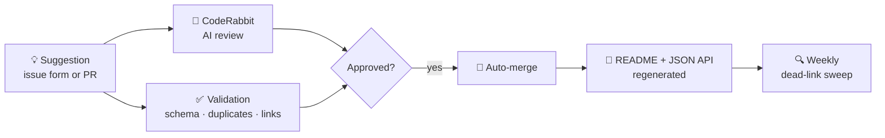

<a id="top"></a>

<div align="center">



<br><br>

<code>// the catalogue, today</code>

<h3>Only the gold. Everything else is noise.</h3>

<p>
  <b>481 hand-picked free and open-source resources</b> for finding jobs, AI coding, winning scholarships,<br>
  learning, building products, and staying secure. Sorted across 16 categories and verified every week.
</p>

[](#contents)
[](#gold-picks)
[](#contents)
[](https://goldlist-seven.vercel.app/)
[](https://github.com/UsmanGhias/goldlist/actions/workflows/links.yml)
[](https://github.com/UsmanGhias/goldlist/stargazers)
[](CONTRIBUTING.md)
[](#how-it-works)
[](https://hub.xerj.org/contributors/UsmanGhias)
[](LICENSE)

<br>

<table>
<tr>
<td align="center" width="25%"><h3>481</h3><sub>verified resources</sub></td>
<td align="center" width="25%"><h3>16</h3><sub>curated topics</sub></td>
<td align="center" width="25%"><h3>349</h3><sub>open-source repos</sub></td>
<td align="center" width="25%"><h3>70</h3><sub>elite gold picks</sub></td>
</tr>
</table>

<br>

[💼 Jobs](#jobs) · [🧭 Career](#career) · [🎓 Scholarships](#scholarships) · [📚 Learning](#learning) · [🧑‍🎓 Students](#students) · [🛠️ Dev Tools](#dev-tools) · [🤖 AI Tools](#ai-tools) · [🧠 AI Coding](#ai-coding) · [🧩 Skills](#agent-skills) · [🔌 MCP](#mcp) · [🎨 Design](#design) · [🎬 Media](#media) · [⚡ Productivity](#productivity) · [🔬 Research](#research) · [🚀 Startups](#startups) · [🔒 Privacy](#privacy-security)

<br><br>

**[🔎 Search &amp; filter all 481 resources on the live website →](https://goldlist-seven.vercel.app/)**

<sub>⭐ <b>Star this repository</b> to keep it one click away. Updated weekly.</sub>

</div>

---

## ⚡ Why GoldList?

Giant awesome-lists drown you in thousands of stale links with zero point of view. GoldList is curated with strict discipline:

- **Curated, not collected:** Every entry earns its place. Categories stay focused so you only see what is worth your time.
- **One clean directory:** Jobs, scholarships, dev tools, Claude skills, MCP servers, and privacy in one unified place.
- **100% active links:** Automated weekly CI checks sweep every single URL. Dead links are caught and resolved immediately.
- **Honest labels:** Explicit open-source licenses, generous free tiers, and live GitHub stars with zero promotional hype.

---

<a id="start-here"></a>

## 🎯 Start Here

| If you are… | Go straight to |
| :--- | :--- |
| 💼 **Hunting for a job** | [Jobs](#jobs) → [Career & Interviews](#career) → [AI Coding](#ai-coding) |
| 🎓 **A student** | [Students](#students) → [Scholarships](#scholarships) → [Learning](#learning) |
| 🌍 **Planning a funded master's or PhD** | [Scholarships](#scholarships) → [Research & Writing](#research) |
| 💻 **Learning to code** | [Learning](#learning) → [Dev Tools](#dev-tools) → [AI Coding](#ai-coding) |
| 🏗️ **Building a product** | [Dev Tools](#dev-tools) → [Startups](#startups) → [Design](#design) |
| 🧩 **Supercharging Claude Code or AI agents** | [Skills](#agent-skills) → [MCP Servers](#mcp) → [AI Coding](#ai-coding) |
| 🤖 **Exploring modern AI** | [AI Tools](#ai-tools) → [AI Coding](#ai-coding) → [Learning](#learning) |
| 🎨 **A creator or designer** | [Design](#design) → [Media](#media) → [Productivity](#productivity) |
| 🔐 **Privacy-conscious** | [Privacy & Security](#privacy-security) → [Productivity](#productivity) |

---

<a id="take-it-with-you"></a>

## 📦 Take It With You

GoldList is machine-readable and agent-ready. Consume it in your terminal, pipe it into AI agents, or show your badge.

<table>
<tr>
<td width="50%" valign="top">

### 💻 Terminal &amp; JSON API
Query the full live dataset from your command line:

```bash
# Stream the raw JSON
curl -sL https://raw.githubusercontent.com/UsmanGhias/goldlist/main/api/goldlist.json | jq .

# List all open-source AI coding tools
curl -sL https://raw.githubusercontent.com/UsmanGhias/goldlist/main/api/goldlist.json \
  | jq '.categories[] | select(.slug=="ai-coding") | .items[] | select(.type=="open-source") | .name'
```

</td>
<td width="50%" valign="top">

### 🤖 AI Agent &amp; Claude Code
GoldList works natively with Claude Code, Antigravity, and Cursor.

Prompt your coding agent:
> *"Fetch the top tools from `https://raw.githubusercontent.com/UsmanGhias/goldlist/main/api/goldlist.json` before recommending libraries."*

All entries include verified URLs, descriptions, and licenses.

</td>
</tr>
</table>

### 🏅 Featured on GoldList Badge

If your tool or open-source project is featured on GoldList, showcase it with pride:

```markdown
[](https://github.com/UsmanGhias/goldlist)
```

**Preview:** [](https://github.com/UsmanGhias/goldlist)

---

<a id="gold-picks"></a>

## 🏆 Gold Picks

The best of the best. If you only open a few links today, make it these.

<table>
<tr>
<td width="33%" valign="top">
 <b><a href="https://clivora.io">Clivora Web</a></b><br>
<sub>Free open-source freelance OS for clients and freelancers with portals, contracts, escrow, and invoicing.</sub><br>
<sub><a href="#jobs">💼 Jobs</a></sub>
</td>
<td width="33%" valign="top">
 <b><a href="https://github.com/UsmanGhias/clivora">Clivora App</a></b><br>
<sub>Free open-source offline-first mobile app for freelance client portals, contracts, and milestone invoicing.</sub><br>
<sub><a href="#jobs">💼 Jobs</a></sub>
</td>
<td width="33%" valign="top">
 <b><a href="https://freehire.me">freehire</a></b><br>
<sub>IT job postings from many boards in one search, each linked back to the original posting.</sub><br>
<sub><a href="#jobs">💼 Jobs</a></sub>
</td>
</tr>
<tr>
<td width="33%" valign="top">
 <b><a href="https://news.ycombinator.com/submitted?id=whoishiring">Hacker News: Who is Hiring</a></b><br>
<sub>Monthly thread where startups post real openings, often remote and often from founders directly.</sub><br>
<sub><a href="#jobs">💼 Jobs</a></sub>
</td>
<td width="33%" valign="top">
 <b><a href="https://github.com/SimplifyJobs/Summer2027-Internships">Simplify Summer 2027 Internships</a></b><br>
<sub>Daily-updated list of tech internships in the US, Canada and remote.</sub><br>
<sub><a href="#jobs">💼 Jobs</a></sub>
</td>
<td width="33%" valign="top">
 <b><a href="https://www.techinterviewhandbook.org">Tech Interview Handbook</a></b><br>
<sub>Concise interview prep covering algorithm cheatsheets, behavioral questions and resume tips.</sub><br>
<sub><a href="#career">🧭 Career</a></sub>
</td>
</tr>
<tr>
<td width="33%" valign="top">
 <b><a href="https://github.com/donnemartin/system-design-primer">System Design Primer</a></b><br>
<sub>The classic guide to designing large-scale systems, with Anki flashcards.</sub><br>
<sub><a href="#career">🧭 Career</a></sub>
</td>
<td width="33%" valign="top">
 <b><a href="https://rxresu.me">Reactive Resume</a></b><br>
<sub>Open-source resume builder with no ads or tracking, exporting to PDF.</sub><br>
<sub><a href="#career">🧭 Career</a></sub>
</td>
<td width="33%" valign="top">
 <b><a href="https://www.eacea.ec.europa.eu/scholarships/erasmus-mundus-catalogue_en">Erasmus Mundus Catalogue</a></b><br>
<sub>Fully funded joint master's programmes taught across several European universities.</sub><br>
<sub><a href="#scholarships">🎓 Scholarships</a></sub>
</td>
</tr>
<tr>
<td width="33%" valign="top">
 <b><a href="https://www2.daad.de/deutschland/stipendium/datenbank/en/21148-scholarship-database/">DAAD Scholarship Database</a></b><br>
<sub>Search funding for studying or doing research in Germany.</sub><br>
<sub><a href="#scholarships">🎓 Scholarships</a></sub>
</td>
<td width="33%" valign="top">
 <b><a href="https://www.freecodecamp.org">freeCodeCamp</a></b><br>
<sub>Full-stack curriculum with free certifications and thousands of exercises.</sub><br>
<sub><a href="#learning">📚 Learning</a></sub>
</td>
<td width="33%" valign="top">
 <b><a href="https://cs50.harvard.edu/x/">CS50x</a></b><br>
<sub>Harvard's famous intro to computer science, free online.</sub><br>
<sub><a href="#learning">📚 Learning</a></sub>
</td>
</tr>
<tr>
<td width="33%" valign="top">
 <b><a href="https://roadmap.sh">roadmap.sh</a></b><br>
<sub>Step-by-step learning roadmaps for every developer role and technology.</sub><br>
<sub><a href="#learning">📚 Learning</a></sub>
</td>
<td width="33%" valign="top">
 <b><a href="https://developer.mozilla.org">MDN Web Docs</a></b><br>
<sub>The reference for HTML, CSS, JavaScript and web APIs.</sub><br>
<sub><a href="#learning">📚 Learning</a></sub>
</td>
<td width="33%" valign="top">
 <b><a href="https://github.com/rasbt/LLMs-from-scratch">LLMs from Scratch</a></b><br>
<sub>Build a ChatGPT-like LLM in PyTorch step by step.</sub><br>
<sub><a href="#learning">📚 Learning</a></sub>
</td>
</tr>
<tr>
<td width="33%" valign="top">
 <b><a href="https://github.com/karpathy/nanoGPT">nanoGPT</a></b><br>
<sub>Simplest, fastest repository for training and finetuning medium GPTs by Andrej Karpathy.</sub><br>
<sub><a href="#learning">📚 Learning</a></sub>
</td>
<td width="33%" valign="top">
 <b><a href="https://github.com/anthropics/courses">Anthropic Courses</a></b><br>
<sub>Official educational courses and notebooks for prompt engineering and Claude development.</sub><br>
<sub><a href="#learning">📚 Learning</a></sub>
</td>
<td width="33%" valign="top">
 <b><a href="https://education.github.com/pack">GitHub Student Developer Pack</a></b><br>
<sub>Free access to dozens of paid developer tools while you study.</sub><br>
<sub><a href="#students">🧑‍🎓 Students</a></sub>
</td>
</tr>
<tr>
<td width="33%" valign="top">
 <b><a href="https://summerofcode.withgoogle.com">Google Summer of Code</a></b><br>
<sub>Paid, mentored program for contributing to open-source projects.</sub><br>
<sub><a href="#students">🧑‍🎓 Students</a></sub>
</td>
<td width="33%" valign="top">
 <b><a href="https://github.com/ripienaar/free-for-dev">free-for-dev</a></b><br>
<sub>Hundreds of SaaS, PaaS and IaaS services with free tiers for developers.</sub><br>
<sub><a href="#dev-tools">🛠️ Dev Tools</a></sub>
</td>
<td width="33%" valign="top">
 <b><a href="https://github.com/public-apis/public-apis">public-apis</a></b><br>
<sub>Collective list of free APIs to build projects on.</sub><br>
<sub><a href="#dev-tools">🛠️ Dev Tools</a></sub>
</td>
</tr>
<tr>
<td width="33%" valign="top">
 <b><a href="https://supabase.com">Supabase</a></b><br>
<sub>Open-source Postgres backend with auth, storage and realtime, plus a free tier.</sub><br>
<sub><a href="#dev-tools">🛠️ Dev Tools</a></sub>
</td>
<td width="33%" valign="top">
 <b><a href="https://github.com/jesseduffield/lazygit">lazygit</a></b><br>
<sub>Terminal UI for git that makes staging, rebasing and stashing painless.</sub><br>
<sub><a href="#dev-tools">🛠️ Dev Tools</a></sub>
</td>
<td width="33%" valign="top">
 <b><a href="https://github.com/astral-sh/uv">uv</a></b><br>
<sub>Extremely fast Python package installer and resolver written in Rust.</sub><br>
<sub><a href="#dev-tools">🛠️ Dev Tools</a></sub>
</td>
</tr>
<tr>
<td width="33%" valign="top">
 <b><a href="https://github.com/astral-sh/ruff">Ruff</a></b><br>
<sub>Extremely fast Python linter and code formatter written in Rust.</sub><br>
<sub><a href="#dev-tools">🛠️ Dev Tools</a></sub>
</td>
<td width="33%" valign="top">
 <b><a href="https://github.com/pocketbase/pocketbase">PocketBase</a></b><br>
<sub>Open source realtime backend in 1 portable Go binary with embedded SQLite.</sub><br>
<sub><a href="#dev-tools">🛠️ Dev Tools</a></sub>
</td>
<td width="33%" valign="top">
 <b><a href="https://github.com/fastapi/fastapi">FastAPI</a></b><br>
<sub>High-performance web framework for building APIs with Python and type hints.</sub><br>
<sub><a href="#dev-tools">🛠️ Dev Tools</a></sub>
</td>
</tr>
<tr>
<td width="33%" valign="top">
 <b><a href="https://caniuse.com">Can I use</a></b><br>
<sub>Up-to-date browser feature support tables for modern HTML, CSS, JavaScript, and Web APIs.</sub><br>
<sub><a href="#dev-tools">🛠️ Dev Tools</a></sub>
</td>
<td width="33%" valign="top">
 <b><a href="https://jsoncrack.com">JSON Crack</a></b><br>
<sub>Interactive visual graph and hierarchical tree viewer for complex JSON structures.</sub><br>
<sub><a href="#dev-tools">🛠️ Dev Tools</a></sub>
</td>
<td width="33%" valign="top">
 <b><a href="https://ollama.com">Ollama</a></b><br>
<sub>Run open LLMs locally with a single command.</sub><br>
<sub><a href="#ai-tools">🤖 AI Tools</a></sub>
</td>
</tr>
<tr>
<td width="33%" valign="top">
 <b><a href="https://aistudio.google.com">Google AI Studio</a></b><br>
<sub>Try Gemini models and get a free API key in minutes.</sub><br>
<sub><a href="#ai-tools">🤖 AI Tools</a></sub>
</td>
<td width="33%" valign="top">
 <b><a href="https://browser-use.com">Browser Use</a></b><br>
<sub>Let AI agents control a real web browser to finish tasks.</sub><br>
<sub><a href="#ai-tools">🤖 AI Tools</a></sub>
</td>
<td width="33%" valign="top">
 <b><a href="https://github.com/microsoft/markitdown">MarkItDown</a></b><br>
<sub>Convert PDFs, Office files and more to Markdown for LLMs.</sub><br>
<sub><a href="#ai-tools">🤖 AI Tools</a></sub>
</td>
</tr>
<tr>
<td width="33%" valign="top">
 <b><a href="https://github.com/mendableai/firecrawl">Firecrawl</a></b><br>
<sub>Turn entire websites into clean LLM-ready markdown or structured data with one call.</sub><br>
<sub><a href="#ai-tools">🤖 AI Tools</a></sub>
</td>
<td width="33%" valign="top">
 <b><a href="https://github.com/google-gemini/gemini-cli">Gemini CLI</a></b><br>
<sub>Google's open-source AI agent for the terminal, with a generous free tier.</sub><br>
<sub><a href="#ai-coding">🧠 AI Coding</a></sub>
</td>
<td width="33%" valign="top">
 <b><a href="https://github.com/github/spec-kit">Spec Kit</a></b><br>
<sub>GitHub's toolkit for spec-driven development that turns specs into plans and tasks for agents.</sub><br>
<sub><a href="#ai-coding">🧠 AI Coding</a></sub>
</td>
</tr>
<tr>
<td width="33%" valign="top">
 <b><a href="https://cline.bot">Cline</a></b><br>
<sub>Autonomous coding agent inside VS Code that plans, edits and runs commands.</sub><br>
<sub><a href="#ai-coding">🧠 AI Coding</a></sub>
</td>
<td width="33%" valign="top">
 <b><a href="https://github.com/opensandbox-group/OpenSandbox">OpenSandbox</a></b><br>
<sub>Secure and lightweight sandbox runtime for autonomous AI coding agents.</sub><br>
<sub><a href="#ai-coding">🧠 AI Coding</a></sub>
</td>
<td width="33%" valign="top">
 <b><a href="https://github.com/NVIDIA/OpenShell">OpenShell</a></b><br>
<sub>Safe, private runtime and sandbox for autonomous AI agent execution by NVIDIA.</sub><br>
<sub><a href="#ai-coding">🧠 AI Coding</a></sub>
</td>
</tr>
<tr>
<td width="33%" valign="top">
 <b><a href="https://github.com/elizaOS/eliza">Eliza</a></b><br>
<sub>Autonomous multi-agent operating system and framework for interactive agents.</sub><br>
<sub><a href="#ai-coding">🧠 AI Coding</a></sub>
</td>
<td width="33%" valign="top">
 <b><a href="https://github.com/DietrichGebert/ponytail">Ponytail</a></b><br>
<sub>Makes your coding agent favor the simplest working solution and write less, leaner code.</sub><br>
<sub><a href="#agent-skills">🧩 Skills</a></sub>
</td>
<td width="33%" valign="top">
 <b><a href="https://github.com/obra/superpowers">Superpowers</a></b><br>
<sub>Skills framework that gives agents a disciplined workflow of brainstorming, planning, TDD and review.</sub><br>
<sub><a href="#agent-skills">🧩 Skills</a></sub>
</td>
</tr>
<tr>
<td width="33%" valign="top">
 <b><a href="https://github.com/nextlevelbuilder/ui-ux-pro-max-skill">UI UX Pro Max Skill</a></b><br>
<sub>Design-intelligence skill that helps AI coding agents build polished, professional UI.</sub><br>
<sub><a href="#agent-skills">🧩 Skills</a></sub>
</td>
<td width="33%" valign="top">
 <b><a href="https://github.com/mukul975/Anthropic-Cybersecurity-Skills">Anthropic Cybersecurity Skills</a></b><br>
<sub>817 structured cybersecurity and penetration testing skills for AI coding agents.</sub><br>
<sub><a href="#agent-skills">🧩 Skills</a></sub>
</td>
<td width="33%" valign="top">
 <b><a href="https://github.com/modelcontextprotocol/servers">MCP Reference Servers</a></b><br>
<sub>Reference Model Context Protocol servers that connect AI agents to tools and data.</sub><br>
<sub><a href="#mcp">🔌 MCP</a></sub>
</td>
</tr>
<tr>
<td width="33%" valign="top">
 <b><a href="https://github.com/upstash/context7">Context7</a></b><br>
<sub>Feeds your agent up-to-date, version-specific library docs so it stops guessing APIs.</sub><br>
<sub><a href="#mcp">🔌 MCP</a></sub>
</td>
<td width="33%" valign="top">
 <b><a href="https://github.com/microsoft/playwright-mcp">Playwright MCP</a></b><br>
<sub>Lets agents drive a real browser to test, click through and read web pages.</sub><br>
<sub><a href="#mcp">🔌 MCP</a></sub>
</td>
<td width="33%" valign="top">
 <b><a href="https://github.com/ChromeDevTools/chrome-devtools-mcp">Chrome DevTools MCP</a></b><br>
<sub>Let agents debug, profile and test pages in a live Chrome.</sub><br>
<sub><a href="#mcp">🔌 MCP</a></sub>
</td>
</tr>
<tr>
<td width="33%" valign="top">
 <b><a href="https://penpot.app">Penpot</a></b><br>
<sub>Open-source design and prototyping tool, an alternative to Figma.</sub><br>
<sub><a href="#design">🎨 Design</a></sub>
</td>
<td width="33%" valign="top">
 <b><a href="https://ui.shadcn.com">shadcn/ui</a></b><br>
<sub>Beautiful, accessible React components you copy into your project.</sub><br>
<sub><a href="#design">🎨 Design</a></sub>
</td>
<td width="33%" valign="top">
 <b><a href="https://github.com/tldraw/tldraw">tldraw</a></b><br>
<sub>Infinite canvas SDK and collaborative digital whiteboard for React applications.</sub><br>
<sub><a href="#design">🎨 Design</a></sub>
</td>
</tr>
<tr>
<td width="33%" valign="top">
 <b><a href="https://github.com/excalidraw/excalidraw">Excalidraw</a></b><br>
<sub>Virtual collaborative whiteboard for sketching hand-drawn diagrams and wireframes.</sub><br>
<sub><a href="#design">🎨 Design</a></sub>
</td>
<td width="33%" valign="top">
 <b><a href="https://www.blackmagicdesign.com/products/davinciresolve">DaVinci Resolve</a></b><br>
<sub>Hollywood-grade video editing and color grading, with a very capable free version.</sub><br>
<sub><a href="#media">🎬 Media</a></sub>
</td>
<td width="33%" valign="top">
 <b><a href="https://obsproject.com">OBS Studio</a></b><br>
<sub>Screen recording and live streaming.</sub><br>
<sub><a href="#media">🎬 Media</a></sub>
</td>
</tr>
<tr>
<td width="33%" valign="top">
 <b><a href="https://ffmpeg.org">FFmpeg</a></b><br>
<sub>The Swiss Army knife for converting and editing audio and video.</sub><br>
<sub><a href="#media">🎬 Media</a></sub>
</td>
<td width="33%" valign="top">
 <b><a href="https://immich.app">Immich</a></b><br>
<sub>Self-hosted Google Photos alternative with mobile backup.</sub><br>
<sub><a href="#media">🎬 Media</a></sub>
</td>
<td width="33%" valign="top">
 <b><a href="https://github.com/alyssaxuu/screenity">Screenity</a></b><br>
<sub>Privacy-friendly browser screen recorder and annotation tool with zero limits.</sub><br>
<sub><a href="#media">🎬 Media</a></sub>
</td>
</tr>
<tr>
<td width="33%" valign="top">
 <b><a href="https://obsidian.md">Obsidian</a></b><br>
<sub>Local-first markdown notes with backlinks and a huge plugin ecosystem.</sub><br>
<sub><a href="#productivity">⚡ Productivity</a></sub>
</td>
<td width="33%" valign="top">
 <b><a href="https://localsend.org">LocalSend</a></b><br>
<sub>Share files between nearby devices with no internet or account.</sub><br>
<sub><a href="#productivity">⚡ Productivity</a></sub>
</td>
<td width="33%" valign="top">
 <b><a href="https://www.stirlingpdf.com">Stirling-PDF</a></b><br>
<sub>Self-hosted toolkit to merge, split, sign, OCR and edit PDFs.</sub><br>
<sub><a href="#productivity">⚡ Productivity</a></sub>
</td>
</tr>
<tr>
<td width="33%" valign="top">
 <b><a href="https://github.com/ajeetdsouza/zoxide">zoxide</a></b><br>
<sub>Smarter cd command that learns navigation habits and jumps across folders fast.</sub><br>
<sub><a href="#productivity">⚡ Productivity</a></sub>
</td>
<td width="33%" valign="top">
 <b><a href="https://www.zotero.org">Zotero</a></b><br>
<sub>Collect, organize and cite research papers, with one-click capture from your browser.</sub><br>
<sub><a href="#research">🔬 Research</a></sub>
</td>
<td width="33%" valign="top">
 <b><a href="https://www.overleaf.com">Overleaf</a></b><br>
<sub>Collaborative LaTeX editor in the browser for papers and theses.</sub><br>
<sub><a href="#research">🔬 Research</a></sub>
</td>
</tr>
<tr>
<td width="33%" valign="top">
 <b><a href="https://colab.research.google.com">Google Colab</a></b><br>
<sub>Free Jupyter notebooks in the cloud with GPU access.</sub><br>
<sub><a href="#research">🔬 Research</a></sub>
</td>
<td width="33%" valign="top">
 <b><a href="https://www.startupschool.org">YC Startup School</a></b><br>
<sub>Y Combinator's free course on how to start a startup, plus co-founder matching.</sub><br>
<sub><a href="#startups">🚀 Startups</a></sub>
</td>
<td width="33%" valign="top">
 <b><a href="https://posthog.com">PostHog</a></b><br>
<sub>Open-source product analytics, session replay and feature flags with a big free tier.</sub><br>
<sub><a href="#startups">🚀 Startups</a></sub>
</td>
</tr>
<tr>
<td width="33%" valign="top">
 <b><a href="https://github.com/Fincept-Corporation/FinceptTerminal">FinceptTerminal</a></b><br>
<sub>Modern financial analytics terminal offering market data and investment research.</sub><br>
<sub><a href="#startups">🚀 Startups</a></sub>
</td>
<td width="33%" valign="top">
 <b><a href="https://bitwarden.com">Bitwarden</a></b><br>
<sub>Open-source password manager with a free plan on every device.</sub><br>
<sub><a href="#privacy-security">🔒 Privacy</a></sub>
</td>
<td width="33%" valign="top">
 <b><a href="https://github.com/gorhill/uBlock">uBlock Origin</a></b><br>
<sub>Efficient, lightweight ad and tracker blocker.</sub><br>
<sub><a href="#privacy-security">🔒 Privacy</a></sub>
</td>
</tr>
<tr>
<td width="33%" valign="top">
 <b><a href="https://portswigger.net/web-security">PortSwigger Web Security Academy</a></b><br>
<sub>Free hands-on labs for every major web vulnerability.</sub><br>
<sub><a href="#privacy-security">🔒 Privacy</a></sub>
</td>
</tr>
</table>

<a id="recently-added"></a>

## 🆕 Recently Added

- **[Can I use](https://caniuse.com)**: Up-to-date browser feature support tables for modern HTML, CSS, JavaScript, and Web APIs. <sub>[🛠️ Dev Tools](#dev-tools) · 2026-11-05</sub>
- **[Crontab.guru](https://crontab.guru)**: Interactive cron schedule expression editor with human-readable plain English definitions. <sub>[🛠️ Dev Tools](#dev-tools) · 2026-11-05</sub>
- **[JSON Crack](https://jsoncrack.com)**: Interactive visual graph and hierarchical tree viewer for complex JSON structures. <sub>[🛠️ Dev Tools](#dev-tools) · 2026-11-05</sub>
- **[Ray.so](https://ray.so)**: Generate beautiful code snippet screenshots with syntax themes, padding, and dark mode. <sub>[🛠️ Dev Tools](#dev-tools) · 2026-11-05</sub>
- **[Bundlephobia](https://bundlephobia.com)**: Find the bundle size and download impact of npm packages before adding them to projects. <sub>[🛠️ Dev Tools](#dev-tools) · 2026-11-05</sub>
- **[Anyps5](https://boykopovar.github.io/AnyPS5/)**: Tool for automatic PS5 executables porting to Linux and Windows. <sub>[🛠️ Dev Tools](#dev-tools) · 2026-11-05</sub>
- **[Mathmodelagent](https://mathmodel.top/home)**: Agent & skills ,自动完成数学建模，生成一份完整的可以直接提交的论文. <sub>[🤖 AI Tools](#ai-tools) · 2026-11-05</sub>
- **[Openmed](https://openmed.life/)**: Local-first healthcare AI: clinical NER and HIPAA PII de-identification on hardware you control. 2,200+ medical. <sub>[🤖 AI Tools](#ai-tools) · 2026-11-05</sub>
- **[Cleanyourtv](https://cleanyour.tv)**: Debloat any Android or Google TV over Wi-Fi and get an Apple TV-style home. <sub>[🧠 AI Coding](#ai-coding) · 2026-11-05</sub>
- **[SVG Repo](https://www.svgrepo.com)**: Search and download 500,000+ free vector SVG icons and illustrations with CC0 license. <sub>[🎨 Design](#design) · 2026-11-05</sub>

<a id="contents"></a>

## 📑 Catalogue Contents

| | Category | What's inside | Picks |
| :-: | :--- | :--- | :-: |
| 💼 | **[Jobs & Freelancing](#jobs)** | Where real openings get posted first, from remote boards to curated GitHub lists. | 22 |
| 🧭 | **[Career & Interviews](#career)** | Resumes, interview prep and salary data to land the offer and negotiate it. | 17 |
| 🎓 | **[Scholarships & Research Funding](#scholarships)** | Funded master's, PhDs and fellowships, so you can study without paying for it. | 22 |
| 📚 | **[Learning & Courses](#learning)** | Free courses and books that are as good as paid ones, often better. | 36 |
| 🧑‍🎓 | **[Students & Programs](#students)** | Free licenses, credits and paid programs available only while you're a student or newcomer. | 16 |
| 🛠️ | **[Developer Tools & Free Tiers](#dev-tools)** | Build, host and ship without a credit card. | 58 |
| 🤖 | **[AI Tools & Models](#ai-tools)** | Run models locally, build AI apps and automate your work. | 37 |
| 🧠 | **[AI Coding Agents & Tools](#ai-coding)** | Terminal coding agents, spec-driven workflows and the tools that make Claude Code better. | 42 |
| 🧩 | **[Claude & Agent Skills](#agent-skills)** | Drop-in skills and plugins that give Claude Code, Codex, Gemini CLI and Antigravity new abilities. | 35 |
| 🔌 | **[MCP Servers](#mcp)** | Model Context Protocol servers that plug your AI agent into docs, browsers, GitHub, design files and databases. | 21 |
| 🎨 | **[Design & UI](#design)** | Icons, fonts, photos and design tools that look premium and cost nothing. | 33 |
| 🎬 | **[Video, Audio & Media](#media)** | Studio-grade editing, recording and stock media at zero cost. | 31 |
| ⚡ | **[Productivity & Everyday Apps](#productivity)** | Notes, office apps and utilities, mostly open-source alternatives to paid apps. | 35 |
| 🔬 | **[Research & Writing](#research)** | Find papers, manage references and write better, for students and researchers. | 19 |
| 🚀 | **[Startups & Business](#startups)** | Launch and run a product, with free credits, analytics, CRM and support tools. | 28 |
| 🔒 | **[Privacy & Security](#privacy-security)** | Protect your accounts, data and devices, and learn security hands-on. | 29 |

**Legend:**  source code is public ·  free to use ·  generous free tier, paid upgrades · 🏆 gold pick

---

<a id="jobs"></a>

## 💼 Jobs & Freelancing

> Where real openings get posted first, from remote boards to curated GitHub lists.<br>
> <sub>22 picks · 5 gold</sub>

| | Resource | Why it's gold | Type | GitHub |
| :-: | :--- | :--- | :-- | :-- |
|  | **[Clivora Web](https://clivora.io)** 🏆 | Free open-source freelance OS for clients and freelancers with portals, contracts, escrow, and invoicing. |  | [](https://github.com/UsmanGhias/clivora-web) |
|  | **[Clivora App](https://github.com/UsmanGhias/clivora)** 🏆 | Free open-source offline-first mobile app for freelance client portals, contracts, and milestone invoicing. |  | [](https://github.com/UsmanGhias/clivora) |
|  | **[freehire](https://freehire.me)** 🏆 | IT job postings from many boards in one search, each linked back to the original posting. |  |  |
|  | **[Hacker News: Who is Hiring](https://news.ycombinator.com/submitted?id=whoishiring)** 🏆 | Monthly thread where startups post real openings, often remote and often from founders directly. |  |  |
|  | **[Simplify Summer 2027 Internships](https://github.com/SimplifyJobs/Summer2027-Internships)** 🏆 | Daily-updated list of tech internships in the US, Canada and remote. |  | [](https://github.com/SimplifyJobs/Summer2027-Internships) |
|  | **[Simplify New Grad Positions](https://github.com/SimplifyJobs/New-Grad-Positions)** | Daily-updated list of new-grad software, data and engineering roles. |  | [](https://github.com/SimplifyJobs/New-Grad-Positions) |
|  | **[Work at a Startup](https://www.workatastartup.com)** | Y Combinator's job board, where one profile lets you apply to hundreds of YC startups. |  |  |
|  | **[remote-jobs](https://github.com/remoteintech/remote-jobs)** | Community-maintained list of remote-friendly tech companies, with regions and tech stacks. |  | [](https://github.com/remoteintech/remote-jobs) |
|  | **[Hiring Without Whiteboards](https://github.com/poteto/hiring-without-whiteboards)** | Companies that skip whiteboard puzzles and hire through practical take-homes and pairing. |  | [](https://github.com/poteto/hiring-without-whiteboards) |
|  | **[JobSpy](https://github.com/speedyapply/JobSpy)** | Python library that scrapes LinkedIn, Indeed, Glassdoor and more into one clean table. |  | [](https://github.com/speedyapply/JobSpy) |
|  | **[We Work Remotely](https://weworkremotely.com)** | One of the largest remote-only job boards, covering dev, design, support and more. |  |  |
|  | **[Remote OK](https://remoteok.com)** | Remote job board with salary ranges and tag-based filters. |  |  |
|  | **[Remotive](https://remotive.com)** | Curated remote tech jobs plus a job-alert newsletter. |  |  |
|  | **[Himalayas](https://himalayas.app)** | Remote job board with detailed company profiles and salary info, free for job seekers. |  |  |
|  | **[Wellfound](https://wellfound.com)** | Startup jobs (formerly AngelList Talent) with salary and equity shown upfront. |  |  |
|  | **[Contra](https://contra.com)** | Commission-free platform where freelancers get hired and paid. |  |  |
|  | **[Working Nomads](https://www.workingnomads.com)** | Curated remote jobs by category, delivered as an email digest. |  |  |
|  | **[career-ops](https://github.com/career-ops-hq/career-ops)** | AI job-search agent that scores jobs against your CV and tailors your resume and cover letter. |  | [](https://github.com/career-ops-hq/career-ops) |
|  | **[Awesome Remote Job](https://github.com/lukasz-madon/awesome-remote-job)** | Curated list of remote job boards, companies and resources. |  | [](https://github.com/lukasz-madon/awesome-remote-job) |
|  | **[Welcome to the Jungle](https://www.welcometothejungle.com)** | Tech jobs with real salary ranges and company insights (formerly Otta). |  |  |
|  | **[Remote Rocketship](https://www.remoterocketship.com)** | Remote jobs pulled straight from company career pages. |  |  |
|  | **[AI Job Search](https://github.com/ai-job-search-dev/ai-job-search)** | Local-first AI agent framework that searches job boards and prepares applications. |  | [](https://github.com/ai-job-search-dev/ai-job-search) |

<p align="right"><a href="#top">↑ Back to top</a></p>

<a id="career"></a>

## 🧭 Career & Interviews

> Resumes, interview prep and salary data to land the offer and negotiate it.<br>
> <sub>17 picks · 3 gold</sub>

| | Resource | Why it's gold | Type | GitHub |
| :-: | :--- | :--- | :-- | :-- |
|  | **[Tech Interview Handbook](https://www.techinterviewhandbook.org)** 🏆 | Concise interview prep covering algorithm cheatsheets, behavioral questions and resume tips. |  | [](https://github.com/yangshun/tech-interview-handbook) |
|  | **[System Design Primer](https://github.com/donnemartin/system-design-primer)** 🏆 | The classic guide to designing large-scale systems, with Anki flashcards. |  | [](https://github.com/donnemartin/system-design-primer) |
|  | **[Reactive Resume](https://rxresu.me)** 🏆 | Open-source resume builder with no ads or tracking, exporting to PDF. |  | [](https://github.com/reactive-resume/reactive-resume) |
|  | **[Grind 75](https://www.techinterviewhandbook.org/grind75)** | Customizable week-by-week LeetCode study plan from the author of Blind 75. |  |  |
|  | **[Coding Interview University](https://github.com/jwasham/coding-interview-university)** | Multi-month self-study plan for becoming a software engineer. |  | [](https://github.com/jwasham/coding-interview-university) |
|  | **[NeetCode](https://neetcode.io)** | Structured LeetCode roadmap with free video explanations for every problem. |  |  |
|  | **[LeetCode](https://leetcode.com)** | The standard platform for practicing coding interview problems. |  |  |
|  | **[Resume Matcher](https://github.com/srbhr/Resume-Matcher)** | Compares your resume with a job description and suggests keywords to improve your match. |  | [](https://github.com/srbhr/Resume-Matcher) |
|  | **[JSON Resume](https://jsonresume.org)** | Open standard for writing your resume as JSON, with themes to render it. |  |  |
|  | **[Overleaf CV Templates](https://www.overleaf.com/latex/templates/tagged/cv)** | Professional LaTeX CV templates you can edit right in the browser. |  |  |
|  | **[Big-O Cheat Sheet](https://www.bigocheatsheet.com)** | Time and space complexity of common algorithms and data structures on one page. |  |  |
|  | **[Levels.fyi](https://www.levels.fyi)** | Crowdsourced compensation data by company, level and location. |  |  |
|  | **[Awesome System Design Resources](https://github.com/ashishps1/awesome-system-design-resources)** | Free resources to learn system design concepts and prep interviews. |  | [](https://github.com/ashishps1/awesome-system-design-resources) |
|  | **[The Algorithms (Python)](https://github.com/TheAlgorithms/Python)** | Every classic algorithm implemented in Python. |  | [](https://github.com/TheAlgorithms/Python) |
|  | **[JavaScript Algorithms](https://github.com/trekhleb/javascript-algorithms)** | Algorithms and data structures in JavaScript with explanations. |  | [](https://github.com/trekhleb/javascript-algorithms) |
|  | **[Developer Portfolios](https://github.com/emmabostian/developer-portfolios)** | Curated showcase of stellar software developer portfolio websites for inspiration. |  | [](https://github.com/emmabostian/developer-portfolios) |
|  | **[Data Science Interview Q&A](https://github.com/youssefHosni/Data-Science-Interview-Questions-Answers)** | Curated preparation questions and answers covering data science and machine learning. |  | [](https://github.com/youssefHosni/Data-Science-Interview-Questions-Answers) |

<p align="right"><a href="#top">↑ Back to top</a></p>

<a id="scholarships"></a>

## 🎓 Scholarships & Research Funding

> Funded master's, PhDs and fellowships, so you can study without paying for it.<br>
> <sub>22 picks · 2 gold</sub>

| | Resource | Why it's gold | Type | GitHub |
| :-: | :--- | :--- | :-- | :-- |
|  | **[Erasmus Mundus Catalogue](https://www.eacea.ec.europa.eu/scholarships/erasmus-mundus-catalogue_en)** 🏆 | Fully funded joint master's programmes taught across several European universities. |  |  |
|  | **[DAAD Scholarship Database](https://www2.daad.de/deutschland/stipendium/datenbank/en/21148-scholarship-database/)** 🏆 | Search funding for studying or doing research in Germany. |  |  |
|  | **[EURAXESS](https://euraxess.ec.europa.eu)** | EU portal for research jobs, PhD positions and fellowships. |  |  |
|  | **[FindAPhD](https://www.findaphd.com)** | Search funded PhD projects worldwide by subject and country. |  |  |
|  | **[Academic Positions](https://academicpositions.com)** | PhD, postdoc and faculty openings, mostly in Europe. |  |  |
|  | **[Marie Skłodowska-Curie Actions](https://marie-sklodowska-curie-actions.ec.europa.eu)** | EU funding for doctoral networks and postdoctoral fellowships. |  |  |
|  | **[ELLIS PhD & Postdoc Program](https://ellis.eu/phd-postdoc)** | Europe-wide machine learning PhD program with co-supervision across countries. |  |  |
|  | **[Google PhD Fellowship](https://research.google/programs-and-events/phd-fellowship/)** | Funding and Google mentorship for PhD students in computer science. |  |  |
|  | **[Fulbright Foreign Student Program](https://foreign.fulbrightonline.org)** | Funded graduate study in the United States for international students. |  |  |
|  | **[Chevening](https://www.chevening.org)** | UK government-funded one-year master's scholarships. |  |  |
|  | **[Commonwealth Scholarships](https://cscuk.fcdo.gov.uk)** | UK-funded master's and PhD scholarships for Commonwealth citizens. |  |  |
|  | **[Swedish Institute Scholarships](https://si.se/en/apply/scholarships/)** | Scholarships covering tuition and living costs for master's study in Sweden. |  |  |
|  | **[Stipendium Hungaricum](https://stipendiumhungaricum.hu)** | Hungarian government scholarships for bachelor's, master's and PhD study. |  |  |
|  | **[Türkiye Scholarships](https://www.turkiyeburslari.gov.tr)** | Turkish government scholarships covering tuition, housing and a monthly stipend. |  |  |
|  | **[Scholars4Dev](https://www.scholars4dev.com)** | International scholarships for students from developing countries. |  |  |
|  | **[Gates Cambridge Scholarship](https://www.gatescambridge.org)** | Full-cost postgraduate scholarships at the University of Cambridge. |  |  |
|  | **[Knight-Hennessy Scholars](https://knight-hennessy.stanford.edu)** | Fully funded graduate study at Stanford for any program. |  |  |
|  | **[Rhodes Scholarship](https://www.rhodeshouse.ox.ac.uk)** | Fully funded postgraduate study at the University of Oxford. |  |  |
|  | **[MEXT Scholarship](https://www.studyinjapan.go.jp/en/smap-stopj-applications-research.html)** | Japanese government scholarship for research and degree study. |  |  |
|  | **[Swiss Government Excellence Scholarships](https://www.sbfi.admin.ch/sbfi/en/home/education/scholarships-and-grants/swiss-government-excellence-scholarships.html)** | Research and PhD scholarships for foreign scholars in Switzerland. |  |  |
|  | **[Eiffel Excellence Scholarship](https://www.campusfrance.org/en/eiffel-scholarship-program-of-excellence)** | French government scholarship for master's and PhD students. |  |  |
|  | **[KAUST Fellowship](https://admissions.kaust.edu.sa)** | Fully funded MS and PhD fellowships in Saudi Arabia with a stipend. |  |  |

<p align="right"><a href="#top">↑ Back to top</a></p>

<a id="learning"></a>

## 📚 Learning & Courses

> Free courses and books that are as good as paid ones, often better.<br>
> <sub>36 picks · 7 gold</sub>

| | Resource | Why it's gold | Type | GitHub |
| :-: | :--- | :--- | :-- | :-- |
|  | **[freeCodeCamp](https://www.freecodecamp.org)** 🏆 | Full-stack curriculum with free certifications and thousands of exercises. |  | [](https://github.com/freeCodeCamp/freeCodeCamp) |
|  | **[CS50x](https://cs50.harvard.edu/x/)** 🏆 | Harvard's famous intro to computer science, free online. |  |  |
|  | **[roadmap.sh](https://roadmap.sh)** 🏆 | Step-by-step learning roadmaps for every developer role and technology. |  | [](https://github.com/nilbuild/developer-roadmap) |
|  | **[The Odin Project](https://www.theodinproject.com)** | Project-based full-stack web development path from zero to job-ready. |  | [](https://github.com/TheOdinProject/curriculum) |
|  | **[Full Stack Open](https://fullstackopen.com)** | University of Helsinki's modern web development course covering React, Node and GraphQL. |  |  |
|  | **[OSSU Computer Science](https://github.com/ossu/computer-science)** | A complete computer science degree path built from free online courses. |  | [](https://github.com/ossu/computer-science) |
|  | **[The Missing Semester](https://missing.csail.mit.edu)** | MIT's course on the tools nobody teaches, like the shell, Git, editors and debugging. |  | [](https://github.com/missing-semester/missing-semester) |
|  | **[build-your-own-x](https://github.com/codecrafters-io/build-your-own-x)** | Learn by rebuilding Git, Redis, Docker, databases and more from scratch. |  | [](https://github.com/codecrafters-io/build-your-own-x) |
|  | **[project-based-learning](https://github.com/practical-tutorials/project-based-learning)** | Curated project tutorials sorted by programming language. |  | [](https://github.com/practical-tutorials/project-based-learning) |
|  | **[Exercism](https://exercism.org)** | Coding exercises in 70+ languages with free human mentoring. |  |  |
|  | **[Learn Git Branching](https://learngitbranching.js.org)** | Interactive visual game that finally makes Git branching click. |  | [](https://github.com/pcottle/learnGitBranching) |
|  | **[MIT OpenCourseWare](https://ocw.mit.edu)** | Lecture notes, videos and exams from thousands of MIT courses. |  |  |
|  | **[free-programming-books](https://github.com/EbookFoundation/free-programming-books)** | Huge list of free programming books in many languages. |  | [](https://github.com/EbookFoundation/free-programming-books) |
|  | **[Neural Networks: Zero to Hero](https://karpathy.ai/zero-to-hero.html)** | Andrej Karpathy builds neural networks and GPT from scratch, step by step. |  |  |
|  | **[Practical Deep Learning (fast.ai)](https://course.fast.ai)** | Hands-on deep learning course for people who already code. |  |  |
|  | **[Hugging Face Learn](https://huggingface.co/learn)** | Free courses on LLMs, AI agents, diffusion models and more. |  |  |
|  | **[Google Machine Learning Crash Course](https://developers.google.com/machine-learning/crash-course)** | Fast-paced, practical intro to machine learning with interactive exercises. |  |  |
|  | **[Kaggle Learn](https://www.kaggle.com/learn)** | Short, hands-on micro-courses in Python, SQL, pandas and machine learning. |  |  |
|  | **[Khan Academy](https://www.khanacademy.org)** | Maths, science and computing lessons for every level. |  |  |
|  | **[javascript.info](https://javascript.info)** | The modern JavaScript tutorial, from basics to advanced topics. |  | [](https://github.com/javascript-tutorial/en.javascript.info) |
|  | **[MDN Web Docs](https://developer.mozilla.org)** 🏆 | The reference for HTML, CSS, JavaScript and web APIs. |  | [](https://github.com/mdn/content) |
|  | **[LLMs from Scratch](https://github.com/rasbt/LLMs-from-scratch)** 🏆 | Build a ChatGPT-like LLM in PyTorch step by step. |  | [](https://github.com/rasbt/LLMs-from-scratch) |
|  | **[ML for Beginners](https://github.com/microsoft/ML-For-Beginners)** | Microsoft's 12-week, 26-lesson classic machine learning curriculum. |  | [](https://github.com/microsoft/ML-For-Beginners) |
|  | **[Generative AI for Beginners](https://github.com/microsoft/generative-ai-for-beginners)** | Microsoft's 21-lesson course on building generative AI apps. |  | [](https://github.com/microsoft/generative-ai-for-beginners) |
|  | **[AI Agents for Beginners](https://github.com/microsoft/ai-agents-for-beginners)** | Microsoft's lessons on building AI agents from the ground up. |  | [](https://github.com/microsoft/ai-agents-for-beginners) |
|  | **[Web Dev for Beginners](https://github.com/microsoft/Web-Dev-For-Beginners)** | Microsoft's 12-week, 24-lesson web development curriculum. |  | [](https://github.com/microsoft/Web-Dev-For-Beginners) |
|  | **[Teach Yourself CS](https://teachyourselfcs.com)** | The best books and lectures to learn computer science on your own. |  |  |
|  | **[Prompt Engineering Guide](https://www.promptingguide.ai)** | Guides, papers and techniques for prompting LLMs and agents. |  | [](https://github.com/dair-ai/Prompt-Engineering-Guide) |
|  | **[Claude Cookbooks](https://github.com/anthropics/claude-cookbooks)** | Copy-ready notebooks for building with Claude. |  | [](https://github.com/anthropics/claude-cookbooks) |
|  | **[Anki](https://apps.ankiweb.net)** | Spaced-repetition flashcards that make anything you learn stick, synced across devices. |  | [](https://github.com/ankitects/anki) |
|  | **[nanoGPT](https://github.com/karpathy/nanoGPT)** 🏆 | Simplest, fastest repository for training and finetuning medium GPTs by Andrej Karpathy. |  | [](https://github.com/karpathy/nanoGPT) |
|  | **[Anthropic Courses](https://github.com/anthropics/courses)** 🏆 | Official educational courses and notebooks for prompt engineering and Claude development. |  | [](https://github.com/anthropics/courses) |
|  | **[HelloGitHub](https://github.com/521xueweihan/HelloGitHub)** | Curated monthly showcase of interesting, entry-level open-source projects. |  | [](https://github.com/521xueweihan/HelloGitHub) |
|  | **[Awesome](https://github.com/sindresorhus/awesome)** | The definitive curated index of awesome lists covering programming and technology. |  | [](https://github.com/sindresorhus/awesome) |
|  | **[Koodo Reader](https://github.com/koodo-reader/koodo-reader)** | Cross-platform open-source ebook manager and reader supporting EPUB, PDF, and MOBI. |  | [](https://github.com/koodo-reader/koodo-reader) |
|  | **[Exercises Dataset](https://github.com/hasaneyldrm/exercises-dataset)** | Comprehensive dataset of 1,324 fitness exercises with animated thumbnails. |  | [](https://github.com/hasaneyldrm/exercises-dataset) |

<p align="right"><a href="#top">↑ Back to top</a></p>

<a id="students"></a>

## 🧑‍🎓 Students & Programs

> Free licenses, credits and paid programs available only while you're a student or newcomer.<br>
> <sub>16 picks · 2 gold</sub>

| | Resource | Why it's gold | Type | GitHub |
| :-: | :--- | :--- | :-- | :-- |
|  | **[GitHub Student Developer Pack](https://education.github.com/pack)** 🏆 | Free access to dozens of paid developer tools while you study. |  |  |
|  | **[Google Summer of Code](https://summerofcode.withgoogle.com)** 🏆 | Paid, mentored program for contributing to open-source projects. |  |  |
|  | **[Outreachy](https://www.outreachy.org)** | Paid remote open-source internships for people underrepresented in tech. |  |  |
|  | **[LFX Mentorship](https://mentorship.lfx.linuxfoundation.org)** | Paid mentorships on Linux Foundation and CNCF open-source projects. |  |  |
|  | **[MLH Fellowship](https://fellowship.mlh.io)** | Remote fellowship programs in open source and software engineering. |  |  |
|  | **[MLH Hackathons](https://mlh.io)** | Student hackathons around the world, in person and online. |  |  |
|  | **[Devpost](https://devpost.com)** | Find online hackathons with real prizes and build your portfolio. |  |  |
|  | **[Hacktoberfest](https://hacktoberfest.com)** | Yearly October event that rewards your first open-source contributions. |  |  |
|  | **[JetBrains Educational Licenses](https://www.jetbrains.com/community/education/)** | Free JetBrains IDEs for students and teachers. |  |  |
|  | **[Azure for Students](https://azure.microsoft.com/en-us/free/students)** | Azure cloud credit for students, with no credit card required. |  |  |
|  | **[Figma for Education](https://www.figma.com/education/)** | Free Figma Education plan for students and educators. |  |  |
|  | **[Microsoft Learn Student Ambassadors](https://mvp.microsoft.com/studentambassadors)** | Microsoft's student community with perks, mentoring and certifications. |  |  |
|  | **[AWS Educate](https://aws.amazon.com/education/awseducate/)** | Free cloud courses and hands-on labs, no credit card required. |  |  |
|  | **[Notion for Education](https://www.notion.com/product/notion-for-education)** | Free Notion Plus plan for students with a school email. |  |  |
|  | **[GitHub Campus Experts](https://education.github.com/experts)** | Training program for student community leaders. |  |  |
|  | **[Coursera Financial Aid](https://www.coursera.support/s/article/209819033-Apply-for-Financial-Aid-or-a-Scholarship)** | Get Coursera courses and certificates free with financial aid. |  |  |

<p align="right"><a href="#top">↑ Back to top</a></p>

<a id="dev-tools"></a>

## 🛠️ Developer Tools & Free Tiers

> Build, host and ship without a credit card.<br>
> <sub>58 picks · 10 gold</sub>

| | Resource | Why it's gold | Type | GitHub |
| :-: | :--- | :--- | :-- | :-- |
|  | **[free-for-dev](https://github.com/ripienaar/free-for-dev)** 🏆 | Hundreds of SaaS, PaaS and IaaS services with free tiers for developers. |  | [](https://github.com/ripienaar/free-for-dev) |
|  | **[public-apis](https://github.com/public-apis/public-apis)** 🏆 | Collective list of free APIs to build projects on. |  | [](https://github.com/public-apis/public-apis) |
|  | **[VS Code](https://code.visualstudio.com)** | Free code editor with a huge extension ecosystem. |  |  |
|  | **[Zed](https://zed.dev)** | Very fast open-source code editor with built-in collaboration and AI. |  | [](https://github.com/zed-industries/zed) |
|  | **[Supabase](https://supabase.com)** 🏆 | Open-source Postgres backend with auth, storage and realtime, plus a free tier. |  | [](https://github.com/supabase/supabase) |
|  | **[Appwrite](https://appwrite.io)** | Open-source backend for web and mobile apps, self-hosted or in the cloud. |  | [](https://github.com/appwrite/appwrite) |
|  | **[Neon](https://neon.tech)** | Serverless Postgres with database branching and a free plan. |  |  |
|  | **[Cloudflare Pages](https://pages.cloudflare.com)** | Deploy static sites and frontends for free on a global CDN. |  |  |
|  | **[Vercel](https://vercel.com)** | Push-to-deploy hosting for frontends and Next.js, with a free Hobby plan. |  |  |
|  | **[Coolify](https://coolify.io)** | Self-hosted alternative to Heroku and Vercel for your own server. |  | [](https://github.com/coollabsio/coolify) |
|  | **[Hoppscotch](https://hoppscotch.io)** | Lightweight open-source API client, an alternative to Postman. |  | [](https://github.com/hoppscotch/hoppscotch) |
|  | **[Bruno](https://www.usebruno.com)** | Offline-first API client that stores collections as plain files in your Git repo. |  | [](https://github.com/usebruno/bruno) |
|  | **[DBeaver](https://dbeaver.io)** | Universal database client for Postgres, MySQL, SQLite and dozens more. |  | [](https://github.com/dbeaver/dbeaver) |
|  | **[Sentry](https://sentry.io)** | Error tracking and performance monitoring with a free developer plan. |  | [](https://github.com/getsentry/sentry) |
|  | **[DevDocs](https://devdocs.io)** | API documentation for hundreds of languages and frameworks, searchable and offline. |  | [](https://github.com/freeCodeCamp/devdocs) |
|  | **[regex101](https://regex101.com)** | Build, test and debug regular expressions with live explanations. |  |  |
|  | **[Let's Encrypt](https://letsencrypt.org)** | Free, automated HTTPS certificates for any website. |  |  |
|  | **[Oh My Zsh](https://ohmyz.sh)** | Framework that makes your terminal far more pleasant, with hundreds of plugins and themes. |  | [](https://github.com/ohmyzsh/ohmyzsh) |
|  | **[awesome-selfhosted](https://github.com/awesome-selfhosted/awesome-selfhosted)** | Free software you can host yourself, sorted by category. |  | [](https://github.com/awesome-selfhosted/awesome-selfhosted) |
|  | **[Neovim](https://neovim.io)** | Hyperextensible Vim-based editor with Lua plugins and built-in LSP. |  | [](https://github.com/neovim/neovim) |
|  | **[fzf](https://github.com/junegunn/fzf)** | Fuzzy finder for the terminal: files, history, processes, anything. |  | [](https://github.com/junegunn/fzf) |
|  | **[ripgrep](https://github.com/BurntSushi/ripgrep)** | Blazing-fast recursive search that respects your .gitignore. |  | [](https://github.com/BurntSushi/ripgrep) |
|  | **[lazygit](https://github.com/jesseduffield/lazygit)** 🏆 | Terminal UI for git that makes staging, rebasing and stashing painless. |  | [](https://github.com/jesseduffield/lazygit) |
|  | **[Starship](https://starship.rs)** | Fast, minimal, customizable prompt for any shell. |  | [](https://github.com/starship/starship) |
|  | **[Uptime Kuma](https://github.com/louislam/uptime-kuma)** | Self-hosted uptime monitoring with status pages and alerts. |  | [](https://github.com/louislam/uptime-kuma) |
|  | **[tldr pages](https://tldr.sh)** | Community cheat sheets with practical examples for console commands. |  | [](https://github.com/tldr-pages/tldr) |
|  | **[Bun](https://bun.sh)** | All-in-one JavaScript runtime, bundler, test runner and package manager. |  | [](https://github.com/oven-sh/bun) |
|  | **[Ghostty](https://ghostty.org)** | Fast, native, GPU-accelerated terminal emulator. |  | [](https://github.com/ghostty-org/ghostty) |
|  | **[Netlify](https://www.netlify.com)** | Deploy static sites and serverless functions with a generous free plan. |  |  |
|  | **[FreeDomain](https://dashboard.digitalplat.org)** | Guide and directory for free domain registration and hands-on DNS configuration. |  | [](https://github.com/DigitalPlatDev/FreeDomain) |
|  | **[Front-End Checklist](https://frontendchecklist.io)** | Comprehensive checklist of HTML, CSS, performance, and accessibility best practices. |  | [](https://github.com/thedaviddias/Front-End-Checklist) |
|  | **[Open Source iOS Apps](https://github.com/dkhamsing/open-source-ios-apps)** | Collaborative catalog of open-source iOS applications across various frameworks. |  | [](https://github.com/dkhamsing/open-source-ios-apps) |
|  | **[Scrcpy](https://github.com/Genymobile/scrcpy)** | Display and control Android devices over USB or TCP/IP with high performance. |  | [](https://github.com/Genymobile/scrcpy) |
|  | **[DBX](https://github.com/t8y2/dbx)** | 25 MB lightweight cross-platform database client supporting 100+ database types. |  | [](https://github.com/t8y2/dbx) |
|  | **[Check If Email Exists](https://github.com/reacherhq/check-if-email-exists)** | Verify email address deliverability via SMTP handshake without sending an email. |  | [](https://github.com/reacherhq/check-if-email-exists) |
|  | **[uv](https://github.com/astral-sh/uv)** 🏆 | Extremely fast Python package installer and resolver written in Rust. |  | [](https://github.com/astral-sh/uv) |
|  | **[Ruff](https://github.com/astral-sh/ruff)** 🏆 | Extremely fast Python linter and code formatter written in Rust. |  | [](https://github.com/astral-sh/ruff) |
|  | **[PocketBase](https://github.com/pocketbase/pocketbase)** 🏆 | Open source realtime backend in 1 portable Go binary with embedded SQLite. |  | [](https://github.com/pocketbase/pocketbase) |
|  | **[fd](https://github.com/sharkdp/fd)** | Simple, fast, and user-friendly command-line alternative to find. |  | [](https://github.com/sharkdp/fd) |
|  | **[FastAPI](https://github.com/fastapi/fastapi)** 🏆 | High-performance web framework for building APIs with Python and type hints. |  | [](https://github.com/fastapi/fastapi) |
|  | **[tRPC](https://github.com/trpc/trpc)** | End-to-end typesafe APIs without code generation or runtime schema bloat. |  | [](https://github.com/trpc/trpc) |
|  | **[Biome](https://github.com/biomejs/biome)** | Fast toolchain for JavaScript and TypeScript that formats and lints in milliseconds. |  | [](https://github.com/biomejs/biome) |
|  | **[Dokploy](https://github.com/Dokploy/dokploy)** | Lightweight self-hostable PaaS alternative to Heroku, Vercel, and Coolify. |  | [](https://github.com/Dokploy/dokploy) |
|  | **[Gum](https://github.com/charmbracelet/gum)** | Tool for glamorous interactive shell scripts and terminal prompts. |  | [](https://github.com/charmbracelet/gum) |
|  | **[Glow](https://github.com/charmbracelet/glow)** | Terminal markdown renderer with styled pager, colors, and syntax highlighting. |  | [](https://github.com/charmbracelet/glow) |
|  | **[Camofox](https://github.com/jo-inc/camofox-browser)** | Stealth headless browser for AI agents that bypasses anti-bot detections. |  | [](https://github.com/jo-inc/camofox-browser) |
|  | **[Public APIs](https://github.com/marcelscruz/public-apis)** | Curated collaborative directory of public APIs for developers across 52 categories. |  | [](https://github.com/marcelscruz/public-apis) |
|  | **[API Mega List](https://github.com/cporter202/API-mega-list)** | Comprehensive collection of free public APIs for rapid application prototyping. |  | [](https://github.com/cporter202/API-mega-list) |
|  | **[ChangeDetection.io](https://github.com/dgtlmoon/changedetection.io)** | Self-hosted website change detection, monitoring, and notification service. |  | [](https://github.com/dgtlmoon/changedetection.io) |
|  | **[APKEditor](https://github.com/REAndroid/APKEditor)** | Android APK reverse engineering and resource modification tool. |  | [](https://github.com/REAndroid/APKEditor) |
|  | **[FreeRDP](https://github.com/FreeRDP/FreeRDP)** | Free and open-source Remote Desktop Protocol client and library implementation. |  | [](https://github.com/FreeRDP/FreeRDP) |
|  | **[LordOS](https://github.com/lordbasex/LordOS)** | Lightweight Debian Linux distribution with Wayland compositor and QuickJS UI. |  | [](https://github.com/lordbasex/LordOS) |
|  | **[Can I use](https://caniuse.com)** 🏆 | Up-to-date browser feature support tables for modern HTML, CSS, JavaScript, and Web APIs. |  | [](https://github.com/fyrd/caniuse) |
|  | **[Crontab.guru](https://crontab.guru)** | Interactive cron schedule expression editor with human-readable plain English definitions. |  |  |
|  | **[JSON Crack](https://jsoncrack.com)** 🏆 | Interactive visual graph and hierarchical tree viewer for complex JSON structures. |  | [](https://github.com/AykutSarac/jsoncrack.com) |
|  | **[Ray.so](https://ray.so)** | Generate beautiful code snippet screenshots with syntax themes, padding, and dark mode. |  | [](https://github.com/raycast/ray-so) |
|  | **[Bundlephobia](https://bundlephobia.com)** | Find the bundle size and download impact of npm packages before adding them to projects. |  | [](https://github.com/pastelsky/bundlephobia) |
|  | **[Anyps5](https://boykopovar.github.io/AnyPS5/)** | Tool for automatic PS5 executables porting to Linux and Windows. |  | [](https://github.com/boykopovar/AnyPS5) |

<p align="right"><a href="#top">↑ Back to top</a></p>

<a id="ai-tools"></a>

## 🤖 AI Tools & Models

> Run models locally, build AI apps and automate your work.<br>
> <sub>37 picks · 5 gold</sub>

| | Resource | Why it's gold | Type | GitHub |
| :-: | :--- | :--- | :-- | :-- |
|  | **[Ollama](https://ollama.com)** 🏆 | Run open LLMs locally with a single command. |  | [](https://github.com/ollama/ollama) |
|  | **[Google AI Studio](https://aistudio.google.com)** 🏆 | Try Gemini models and get a free API key in minutes. |  |  |
|  | **[NotebookLM](https://notebooklm.google)** | Upload your sources and get grounded answers, summaries and audio overviews. |  |  |
|  | **[Open WebUI](https://github.com/open-webui/open-webui)** | Self-hosted ChatGPT-style interface for local and API models. |  | [](https://github.com/open-webui/open-webui) |
|  | **[LM Studio](https://lmstudio.ai)** | Desktop app to discover, download and chat with local LLMs. |  |  |
|  | **[llama.cpp](https://github.com/ggml-org/llama.cpp)** | Fast LLM inference in C/C++ that runs on almost any hardware. |  | [](https://github.com/ggml-org/llama.cpp) |
|  | **[vLLM](https://github.com/vllm-project/vllm)** | High-throughput engine for serving LLMs in production. |  | [](https://github.com/vllm-project/vllm) |
|  | **[Hugging Face](https://huggingface.co)** | Hub of open models, datasets and live demo apps. |  |  |
|  | **[Unsloth](https://github.com/unslothai/unsloth)** | Fine-tune open LLMs faster and with much less GPU memory. |  | [](https://github.com/unslothai/unsloth) |
|  | **[Dify](https://github.com/langgenius/dify)** | Visual platform for building LLM apps, RAG pipelines and agents. |  | [](https://github.com/langgenius/dify) |
|  | **[AnythingLLM](https://github.com/Mintplex-Labs/anything-llm)** | Private all-in-one app for chatting with your documents using any LLM. |  | [](https://github.com/Mintplex-Labs/anything-llm) |
|  | **[n8n](https://github.com/n8n-io/n8n)** | Fair-code workflow automation with AI agents, free to self-host as the Community Edition. |  | [](https://github.com/n8n-io/n8n) |
|  | **[ComfyUI](https://github.com/Comfy-Org/ComfyUI)** | Node-based interface for image and video generation models. |  | [](https://github.com/Comfy-Org/ComfyUI) |
|  | **[Whisper](https://github.com/openai/whisper)** | OpenAI's open-source multilingual speech-to-text model. |  | [](https://github.com/openai/whisper) |
|  | **[awesome-llm-apps](https://github.com/Shubhamsaboo/awesome-llm-apps)** | 100+ open-source AI agent, RAG and LLM app examples you can run and learn from. |  | [](https://github.com/Shubhamsaboo/awesome-llm-apps) |
|  | **[LangChain](https://www.langchain.com)** | The most used framework for building LLM apps and agents. |  | [](https://github.com/langchain-ai/langchain) |
|  | **[LlamaIndex](https://www.llamaindex.ai)** | Data framework for connecting your documents to LLMs (RAG). |  | [](https://github.com/run-llama/llama_index) |
|  | **[Jan](https://jan.ai)** | Offline ChatGPT alternative that runs models 100% on your computer. |  | [](https://github.com/janhq/jan) |
|  | **[Langflow](https://www.langflow.org)** | Visual drag-and-drop builder for AI agents and RAG flows. |  | [](https://github.com/langflow-ai/langflow) |
|  | **[Browser Use](https://browser-use.com)** 🏆 | Let AI agents control a real web browser to finish tasks. |  | [](https://github.com/browser-use/browser-use) |
|  | **[Firecrawl](https://www.firecrawl.dev)** | Turn any website into clean, LLM-ready markdown or data. |  | [](https://github.com/firecrawl/firecrawl) |
|  | **[CrewAI](https://crewai.com)** | Framework for orchestrating teams of role-playing AI agents. |  | [](https://github.com/crewAIInc/crewAI) |
|  | **[LiteLLM](https://www.litellm.ai)** | Call 100+ LLM APIs in the OpenAI format, with a proxy and cost tracking. |  | [](https://github.com/BerriAI/litellm) |
|  | **[RAGFlow](https://ragflow.io)** | RAG engine with deep document understanding for reliable answers. |  | [](https://github.com/infiniflow/ragflow) |
|  | **[MarkItDown](https://github.com/microsoft/markitdown)** 🏆 | Convert PDFs, Office files and more to Markdown for LLMs. |  | [](https://github.com/microsoft/markitdown) |
|  | **[LobeHub](https://lobehub.com)** | Open-source AI workspace for chats and teams of agents across many model providers. |  | [](https://github.com/lobehub/lobehub) |
|  | **[OpenRouter](https://openrouter.ai)** | One API for hundreds of models, including many free ones. |  |  |
|  | **[Free LLM API](https://freellmapi.co)** | Curated index of 34 free LLM providers and quota-free API endpoints. |  | [](https://github.com/tashfeenahmed/freellmapi) |
|  | **[OpenHuman](https://tinyhumans.ai/openhuman)** | Lightweight and fast open-source agent harness designed for autonomous task execution. |  | [](https://github.com/tinyhumansai/openhuman) |
|  | **[AirLLM](https://github.com/lyogavin/airllm)** | Runs 70B+ LLM inference locally on single desktop GPUs with layer-wise memory swapping. |  | [](https://github.com/lyogavin/airllm) |
|  | **[Khoj](https://khoj.dev)** | Self-hostable desktop AI personal assistant that searches across your notes and docs. |  | [](https://github.com/khoj-ai/khoj) |
|  | **[500 Ai Machine Learning Deep Learning Computer Vision Nlp Projects With Code](https://github.com/ashishpatel26/500-AI-Machine-learning-Deep-learning-Computer-vision-NLP-Projects-with-code)** | 500 AI Machine learning Deep learning Computer vision NLP Projects with code. |  | [](https://github.com/ashishpatel26/500-AI-Machine-learning-Deep-learning-Computer-vision-NLP-Projects-with-code) |
|  | **[Firecrawl](https://github.com/mendableai/firecrawl)** 🏆 | Turn entire websites into clean LLM-ready markdown or structured data with one call. |  | [](https://github.com/mendableai/firecrawl) |
|  | **[Jina Reader](https://github.com/jina-ai/reader)** | Convert any webpage into clean markdown for LLMs by prefixing r.jina.ai to the URL. |  | [](https://github.com/jina-ai/reader) |
|  | **[Strata](https://github.com/Niko1221/Strata)** | Run high-performance open LLMs on consumer GPUs with one-click desktop setup. |  | [](https://github.com/Niko1221/Strata) |
|  | **[Mathmodelagent](https://mathmodel.top/home)** | Agent & skills ,自动完成数学建模，生成一份完整的可以直接提交的论文. |  | [](https://github.com/jihe520/MathModelAgent) |
|  | **[Openmed](https://openmed.life/)** | Local-first healthcare AI: clinical NER and HIPAA PII de-identification on hardware you control. 2,200+ medical. |  | [](https://github.com/maziyarpanahi/openmed) |

<p align="right"><a href="#top">↑ Back to top</a></p>

<a id="ai-coding"></a>

## 🧠 AI Coding Agents & Tools

> Terminal coding agents, spec-driven workflows and the tools that make Claude Code better.<br>
> <sub>42 picks · 6 gold</sub>

| | Resource | Why it's gold | Type | GitHub |
| :-: | :--- | :--- | :-- | :-- |
|  | **[Gemini CLI](https://github.com/google-gemini/gemini-cli)** 🏆 | Google's open-source AI agent for the terminal, with a generous free tier. |  | [](https://github.com/google-gemini/gemini-cli) |
|  | **[Codex CLI](https://github.com/openai/codex)** | OpenAI's open-source coding agent that runs in your terminal. |  | [](https://github.com/openai/codex) |
|  | **[Aider](https://github.com/Aider-AI/aider)** | AI pair programming in your terminal that edits your Git repo directly. |  | [](https://github.com/Aider-AI/aider) |
|  | **[Continue](https://github.com/continuedev/continue)** | Open-source AI code assistant for VS Code and JetBrains, using any model. |  | [](https://github.com/continuedev/continue) |
|  | **[OpenHands](https://github.com/OpenHands/OpenHands)** | Open-source autonomous software engineering agent. |  | [](https://github.com/OpenHands/OpenHands) |
|  | **[Spec Kit](https://github.com/github/spec-kit)** 🏆 | GitHub's toolkit for spec-driven development that turns specs into plans and tasks for agents. |  | [](https://github.com/github/spec-kit) |
|  | **[BMAD Method](https://github.com/bmad-code-org/BMAD-METHOD)** | Agile AI-driven development method with specialized agents for planning, architecture and delivery. |  | [](https://github.com/bmad-code-org/BMAD-METHOD) |
|  | **[Claude Code Templates](https://github.com/davila7/claude-code-templates)** | CLI for configuring and monitoring Claude Code, with ready-made agents, commands and hooks. |  | [](https://github.com/davila7/claude-code-templates) |
|  | **[Claude HUD](https://github.com/jarrodwatts/claude-hud)** | Claude Code plugin showing context usage, active tools, running agents and todo progress. |  | [](https://github.com/jarrodwatts/claude-hud) |
|  | **[ccusage](https://github.com/ccusage/ccusage)** | Analyze Claude Code token usage and costs from your local logs. |  | [](https://github.com/ccusage/ccusage) |
|  | **[Vibe Kanban](https://github.com/BloopAI/vibe-kanban)** | Kanban board for planning and running Claude Code, Codex and other coding agents. |  | [](https://github.com/BloopAI/vibe-kanban) |
|  | **[CC Switch](https://github.com/farion1231/cc-switch)** | Desktop app to manage providers and settings for Claude Code, Codex and other CLI agents. |  | [](https://github.com/farion1231/cc-switch) |
|  | **[Claude Code Router](https://github.com/musistudio/claude-code-router)** | Route Claude Code requests to the models and providers you choose. |  | [](https://github.com/musistudio/claude-code-router) |
|  | **[Claude How-To](https://github.com/luongnv89/claude-howto)** | Visual, example-driven guide to Claude Code with copy-paste templates. |  | [](https://github.com/luongnv89/claude-howto) |
|  | **[Learn Claude Code](https://github.com/shareAI-lab/learn-claude-code)** | Build a nano Claude Code-style agent harness from scratch to learn how it works. |  | [](https://github.com/shareAI-lab/learn-claude-code) |
|  | **[awesome-claude-code](https://github.com/hesreallyhim/awesome-claude-code)** | Hand-picked skills, agents, hooks, status lines and tooling for Claude Code. |  | [](https://github.com/hesreallyhim/awesome-claude-code) |
|  | **[Cline](https://cline.bot)** 🏆 | Autonomous coding agent inside VS Code that plans, edits and runs commands. |  | [](https://github.com/cline/cline) |
|  | **[Goose](https://goose-docs.ai)** | Local, extensible AI agent that installs, runs, edits and tests code with any LLM. |  | [](https://github.com/aaif-goose/goose) |
|  | **[OpenCode](https://opencode.ai)** | Open-source AI coding agent built for the terminal, any model. |  | [](https://github.com/anomalyco/opencode) |
|  | **[Tabby](https://www.tabbyml.com)** | Self-hosted AI coding assistant, an open alternative to Copilot. |  | [](https://github.com/TabbyML/tabby) |
|  | **[bolt.diy](https://github.com/stackblitz-labs/bolt.diy)** | Prompt, run and edit full-stack web apps in the browser, any LLM. |  | [](https://github.com/stackblitz-labs/bolt.diy) |
|  | **[Repomix](https://repomix.com)** | Pack a whole repository into one AI-friendly file. |  | [](https://github.com/yamadashy/repomix) |
|  | **[Gitingest](https://gitingest.com)** | Turn any GitHub repo into a prompt-ready text digest. |  | [](https://github.com/coderamp-labs/gitingest) |
|  | **[Crush](https://github.com/charmbracelet/crush)** | Glamorous terminal AI coding agent from Charm. |  | [](https://github.com/charmbracelet/crush) |
|  | **[Claude Code Action](https://github.com/anthropics/claude-code-action)** | Run Claude Code in GitHub Actions to review PRs and fix issues. |  | [](https://github.com/anthropics/claude-code-action) |
|  | **[OmniRoute](https://www.omniroute.online/)** | MIT-licensed unified AI proxy routing requests across 375 model providers. |  | [](https://github.com/cheaper-inference/OmniRoute) |
|  | **[System Prompts Leaks](https://github.com/asgeirtj/system_prompts_leaks)** | Documented system prompts from Anthropic Claude, OpenAI ChatGPT, Gemini, and Cursor. |  | [](https://github.com/asgeirtj/system_prompts_leaks) |
|  | **[Free Claude Code](https://github.com/Alishahryar1/free-claude-code)** | Setup and routing guide to use Claude Code and agent CLIs with free token providers. |  | [](https://github.com/Alishahryar1/free-claude-code) |
|  | **[Open Code Review](https://open-codereview.ai)** | Automated code review engine that inspects pull requests for security and quality. |  | [](https://github.com/alibaba/open-code-review) |
|  | **[DeepSeek Harness](https://github.com/deepseek-ai/deepseek-harness)** | Modular agent execution harness and plugin framework for deep reasoning models. |  | [](https://github.com/deepseek-ai/deepseek-harness) |
|  | **[Open Code Review](https://github.com/alibaba/open-code-review)** | Hybrid automated code review engine pairing static rules with LLM agents. |  | [](https://github.com/alibaba/open-code-review) |
|  | **[OpenViking](https://github.com/volcengine/OpenViking)** | Self-evolving context database and persistent memory engine for AI coding agents. |  | [](https://github.com/volcengine/OpenViking) |
|  | **[AgentMemory](https://github.com/rohitg00/agentmemory)** | Persistent memory framework for AI coding agents benchmarked against long contexts. |  | [](https://github.com/rohitg00/agentmemory) |
|  | **[FirstMate](https://github.com/kunchenguid/firstmate)** | Multi-agent autonomous shipping framework coordinating specialized coding subagents. |  | [](https://github.com/kunchenguid/firstmate) |
|  | **[OpenSandbox](https://github.com/opensandbox-group/OpenSandbox)** 🏆 | Secure and lightweight sandbox runtime for autonomous AI coding agents. |  | [](https://github.com/opensandbox-group/OpenSandbox) |
|  | **[OpenShell](https://github.com/NVIDIA/OpenShell)** 🏆 | Safe, private runtime and sandbox for autonomous AI agent execution by NVIDIA. |  | [](https://github.com/NVIDIA/OpenShell) |
|  | **[Eliza](https://github.com/elizaOS/eliza)** 🏆 | Autonomous multi-agent operating system and framework for interactive agents. |  | [](https://github.com/elizaOS/eliza) |
|  | **[Agno](https://github.com/agno-agi/agno)** | Lightweight framework for building multi-modal AI agents with memory and tools. |  | [](https://github.com/agno-agi/agno) |
|  | **[CopilotKit](https://github.com/CopilotKit/CopilotKit)** | Open-source framework to embed custom AI copilots and in-app agent sidebars. |  | [](https://github.com/CopilotKit/CopilotKit) |
|  | **[9Router](https://github.com/decolua/9router)** | Multi-provider routing gateway connecting Claude Code, Codex, and Cursor. |  | [](https://github.com/decolua/9router) |
|  | **[T3 Code](https://github.com/pingdotgg/t3code)** | Full-stack web application scaffolding and agentic code generator by Theo. |  | [](https://github.com/pingdotgg/t3code) |
|  | **[Cleanyourtv](https://cleanyour.tv)** | Debloat any Android or Google TV over Wi-Fi and get an Apple TV-style home. |  | [](https://github.com/Gathin23/cleanyourtv) |

<p align="right"><a href="#top">↑ Back to top</a></p>

<a id="agent-skills"></a>

## 🧩 Claude & Agent Skills

> Drop-in skills and plugins that give Claude Code, Codex, Gemini CLI and Antigravity new abilities.<br>
> <sub>35 picks · 4 gold</sub>

| | Resource | Why it's gold | Type | GitHub |
| :-: | :--- | :--- | :-- | :-- |
|  | **[Ponytail](https://github.com/DietrichGebert/ponytail)** 🏆 | Makes your coding agent favor the simplest working solution and write less, leaner code. |  | [](https://github.com/DietrichGebert/ponytail) |
|  | **[Superpowers](https://github.com/obra/superpowers)** 🏆 | Skills framework that gives agents a disciplined workflow of brainstorming, planning, TDD and review. |  | [](https://github.com/obra/superpowers) |
|  | **[UI UX Pro Max Skill](https://github.com/nextlevelbuilder/ui-ux-pro-max-skill)** 🏆 | Design-intelligence skill that helps AI coding agents build polished, professional UI. |  | [](https://github.com/nextlevelbuilder/ui-ux-pro-max-skill) |
|  | **[Anthropic Agent Skills](https://github.com/anthropics/skills)** | Official example skills for Claude covering documents, design and development. |  | [](https://github.com/anthropics/skills) |
|  | **[awesome-agent-skills](https://github.com/VoltAgent/awesome-agent-skills)** | 1,000+ agent skills for Claude Code, Codex, Cursor and other agents. |  | [](https://github.com/VoltAgent/awesome-agent-skills) |
|  | **[ECC](https://github.com/affaan-m/ECC)** | Agent harness optimization system with skills, memory, security checks and research-first workflows. |  | [](https://github.com/affaan-m/ECC) |
|  | **[gstack](https://github.com/garrytan/gstack)** | Garry Tan's Claude Code setup, with opinionated tools that act as CEO, designer, eng manager and QA. |  | [](https://github.com/garrytan/gstack) |
|  | **[Agent Skills by Addy Osmani](https://github.com/addyosmani/agent-skills)** | Production-grade engineering skills for AI coding agents. |  | [](https://github.com/addyosmani/agent-skills) |
|  | **[Claude Code Plugins (Official)](https://github.com/anthropics/claude-plugins-official)** | Anthropic-managed directory of high-quality Claude Code plugins. |  | [](https://github.com/anthropics/claude-plugins-official) |
|  | **[Taste Skill](https://github.com/Leonxlnx/taste-skill)** | Gives coding agents design taste through art direction, reference images and a browser check. |  | [](https://github.com/Leonxlnx/taste-skill) |
|  | **[Hallmark](https://github.com/Nutlope/hallmark)** | Anti-AI-slop design skill for Claude Code, Cursor and Codex. |  | [](https://github.com/Nutlope/hallmark) |
|  | **[claude-mem](https://github.com/thedotmack/claude-mem)** | Captures what your agent does and feeds the relevant context back into future sessions. |  | [](https://github.com/thedotmack/claude-mem) |
|  | **[Planning with Files](https://github.com/OthmanAdi/planning-with-files)** | Persistent markdown plans that survive /clear and compaction during long-running agent tasks. |  | [](https://github.com/OthmanAdi/planning-with-files) |
|  | **[Compound Engineering](https://github.com/EveryInc/compound-engineering-plugin)** | Every's plan, build and review plugin, where each finished task makes the next one easier. |  | [](https://github.com/EveryInc/compound-engineering-plugin) |
|  | **[Archify](https://github.com/tt-a1i/archify)** | Turns any idea, plan or codebase into an interactive diagram. |  | [](https://github.com/tt-a1i/archify) |
|  | **[last30days](https://github.com/mvanhorn/last30days-skill)** | Researches any topic across Reddit, X, YouTube, HN and the web, then writes a grounded summary. |  | [](https://github.com/mvanhorn/last30days-skill) |
|  | **[Humanizer](https://github.com/blader/humanizer)** | Removes the telltale signs of AI-generated writing from text. |  | [](https://github.com/blader/humanizer) |
|  | **[Marketing Skills](https://github.com/coreyhaines31/marketingskills)** | Skills for CRO, copywriting, SEO, analytics and growth engineering. |  | [](https://github.com/coreyhaines31/marketingskills) |
|  | **[Scientific Agent Skills](https://github.com/K-Dense-AI/scientific-agent-skills)** | Ready-to-use skills and scientific databases for biology, chemistry, medicine and drug discovery. |  | [](https://github.com/K-Dense-AI/scientific-agent-skills) |
|  | **[Obsidian Skills](https://github.com/kepano/obsidian-skills)** | Skills from Obsidian's CEO that teach agents the Obsidian CLI and formats like Bases and JSON Canvas. |  | [](https://github.com/kepano/obsidian-skills) |
|  | **[Security Audit Skill](https://github.com/cloudflare/security-audit-skill)** | Cloudflare's multi-phase security audit skill with independently verified, machine-readable findings. |  | [](https://github.com/cloudflare/security-audit-skill) |
|  | **[Vercel Agent Skills](https://github.com/vercel-labs/agent-skills)** | Vercel's official collection of agent skills. |  | [](https://github.com/vercel-labs/agent-skills) |
|  | **[Google Skills](https://github.com/google/skills)** | Official agent skills for Google products and technologies. |  | [](https://github.com/google/skills) |
|  | **[Agents Plugin Marketplace](https://github.com/wshobson/agents)** | Plugin marketplace of agents and skills for Claude Code, Codex, Cursor, Copilot and Antigravity. |  | [](https://github.com/wshobson/agents) |
|  | **[Claude Code Subagents](https://github.com/VoltAgent/awesome-claude-code-subagents)** | 100+ specialized subagents for Claude Code across many development use cases. |  | [](https://github.com/VoltAgent/awesome-claude-code-subagents) |
|  | **[skills CLI](https://github.com/vercel-labs/skills)** | Install and manage agent skills from the open ecosystem with npx skills. |  | [](https://github.com/vercel-labs/skills) |
|  | **[SkillSpector](https://github.com/NVIDIA/SkillSpector)** | Scans agent skills for prompt injection, data exfiltration and supply-chain risks before you install. |  | [](https://github.com/NVIDIA/SkillSpector) |
|  | **[awesome-claude-skills](https://github.com/ComposioHQ/awesome-claude-skills)** | Curated list of Claude Skills, resources and tools. |  | [](https://github.com/ComposioHQ/awesome-claude-skills) |
|  | **[Agent Reach](https://github.com/Panniantong/Agent-Reach)** | Toolkit giving AI coding agents web and social scraping capabilities. |  | [](https://github.com/Panniantong/Agent-Reach) |
|  | **[Impeccable](https://github.com/pbakaus/impeccable)** | Design vocabulary and editorial polish skill for AI coding agents. |  | [](https://github.com/pbakaus/impeccable) |
|  | **[Diagram Design](https://github.com/cathrynlavery/diagram-design)** | Editorial diagram design skill for Claude Code, Codex, and GitHub Copilot. |  | [](https://github.com/cathrynlavery/diagram-design) |
|  | **[Claude Ads](https://github.com/AgriciDaniel/claude-ads)** | Paid-media operations and ad management skill for Claude Code across 12 platforms. |  | [](https://github.com/AgriciDaniel/claude-ads) |
|  | **[Anthropic Cybersecurity Skills](https://github.com/mukul975/Anthropic-Cybersecurity-Skills)** 🏆 | 817 structured cybersecurity and penetration testing skills for AI coding agents. |  | [](https://github.com/mukul975/Anthropic-Cybersecurity-Skills) |
|  | **[Book to Skill](https://github.com/virgiliojr94/book-to-skill)** | Turn any technical book PDF into an indexed Claude Code skill ready for queries. |  | [](https://github.com/virgiliojr94/book-to-skill) |
|  | **[I Have ADHD](https://github.com/ayghri/i-have-adhd)** | Agent skill that keeps AI coding outputs concise, structured, and slop-free. |  | [](https://github.com/ayghri/i-have-adhd) |

<p align="right"><a href="#top">↑ Back to top</a></p>

<a id="mcp"></a>

## 🔌 MCP Servers

> Model Context Protocol servers that plug your AI agent into docs, browsers, GitHub, design files and databases.<br>
> <sub>21 picks · 4 gold</sub>

| | Resource | Why it's gold | Type | GitHub |
| :-: | :--- | :--- | :-- | :-- |
|  | **[MCP Reference Servers](https://github.com/modelcontextprotocol/servers)** 🏆 | Reference Model Context Protocol servers that connect AI agents to tools and data. |  | [](https://github.com/modelcontextprotocol/servers) |
|  | **[Context7](https://github.com/upstash/context7)** 🏆 | Feeds your agent up-to-date, version-specific library docs so it stops guessing APIs. |  | [](https://github.com/upstash/context7) |
|  | **[Playwright MCP](https://github.com/microsoft/playwright-mcp)** 🏆 | Lets agents drive a real browser to test, click through and read web pages. |  | [](https://github.com/microsoft/playwright-mcp) |
|  | **[GitHub MCP Server](https://github.com/github/github-mcp-server)** | GitHub's official MCP server for issues, pull requests, code and Actions. |  | [](https://github.com/github/github-mcp-server) |
|  | **[Serena](https://github.com/oraios/serena)** | Semantic code search and editing tools that work like an IDE for your agent. |  | [](https://github.com/oraios/serena) |
|  | **[Figma Context MCP](https://github.com/GLips/Figma-Context-MCP)** | Gives coding agents Figma layout data so they implement designs accurately. |  | [](https://github.com/GLips/Figma-Context-MCP) |
|  | **[MCP Toolbox for Databases](https://github.com/googleapis/mcp-toolbox)** | Google's open-source MCP server for connecting agents to your databases. |  | [](https://github.com/googleapis/mcp-toolbox) |
|  | **[FastMCP](https://github.com/PrefectHQ/fastmcp)** | The fast, Pythonic way to build MCP servers and clients. |  | [](https://github.com/PrefectHQ/fastmcp) |
|  | **[MCP Inspector](https://github.com/modelcontextprotocol/inspector)** | Visual tool for testing and debugging MCP servers. |  | [](https://github.com/modelcontextprotocol/inspector) |
|  | **[MCP for Beginners](https://github.com/microsoft/mcp-for-beginners)** | Microsoft's free MCP curriculum with examples in Python, TypeScript, .NET, Java and Rust. |  | [](https://github.com/microsoft/mcp-for-beginners) |
|  | **[awesome-mcp-servers](https://github.com/punkpeye/awesome-mcp-servers)** | Large community directory of MCP servers, sorted by category. |  | [](https://github.com/punkpeye/awesome-mcp-servers) |
|  | **[Chrome DevTools MCP](https://github.com/ChromeDevTools/chrome-devtools-mcp)** 🏆 | Let agents debug, profile and test pages in a live Chrome. |  | [](https://github.com/ChromeDevTools/chrome-devtools-mcp) |
|  | **[Desktop Commander](https://github.com/wonderwhy-er/DesktopCommanderMCP)** | MCP server for terminal commands, file search and edits on your machine. |  | [](https://github.com/wonderwhy-er/DesktopCommanderMCP) |
|  | **[Notion MCP Server](https://github.com/makenotion/notion-mcp-server)** | Official MCP server for the Notion API. |  | [](https://github.com/makenotion/notion-mcp-server) |
|  | **[Supabase MCP](https://supabase.com/mcp)** | Connect agents to your Supabase projects, tables and logs. |  | [](https://github.com/supabase/mcp) |
|  | **[Exa MCP](https://github.com/exa-labs/exa-mcp-server)** | Real-time web search and crawling for agents via Exa. |  | [](https://github.com/exa-labs/exa-mcp-server) |
|  | **[Firecrawl MCP](https://github.com/firecrawl/firecrawl-mcp-server)** | Scrape, crawl and search the web from any MCP client. |  | [](https://github.com/firecrawl/firecrawl-mcp-server) |
|  | **[Blender MCP](https://github.com/ahujasid/mcp-for-blender)** | Community plugin that lets Claude and other LLMs control Blender 3D. |  | [](https://github.com/ahujasid/mcp-for-blender) |
|  | **[MCP TypeScript SDK](https://github.com/modelcontextprotocol/typescript-sdk)** | Official TypeScript SDK for building MCP servers and clients. |  | [](https://github.com/modelcontextprotocol/typescript-sdk) |
|  | **[MCP Python SDK](https://github.com/modelcontextprotocol/python-sdk)** | Official Python SDK for building MCP servers and clients. |  | [](https://github.com/modelcontextprotocol/python-sdk) |
|  | **[WorldMonitor](https://worldmonitor.app)** | Real-time global intelligence dashboard with AI news aggregation and OSINT monitoring. |  | [](https://github.com/koala73/worldmonitor) |

<p align="right"><a href="#top">↑ Back to top</a></p>

<a id="design"></a>

## 🎨 Design & UI

> Icons, fonts, photos and design tools that look premium and cost nothing.<br>
> <sub>33 picks · 4 gold</sub>

| | Resource | Why it's gold | Type | GitHub |
| :-: | :--- | :--- | :-- | :-- |
|  | **[Penpot](https://penpot.app)** 🏆 | Open-source design and prototyping tool, an alternative to Figma. |  | [](https://github.com/penpot/penpot) |
|  | **[shadcn/ui](https://ui.shadcn.com)** 🏆 | Beautiful, accessible React components you copy into your project. |  | [](https://github.com/shadcn-ui/ui) |
|  | **[Tailwind CSS](https://tailwindcss.com)** | Utility-first CSS framework for building any design without leaving your HTML. |  | [](https://github.com/tailwindlabs/tailwindcss) |
|  | **[Excalidraw](https://excalidraw.com)** | Hand-drawn style whiteboard for diagrams and sketches. |  | [](https://github.com/excalidraw/excalidraw) |
|  | **[Inkscape](https://inkscape.org)** | Professional vector graphics editor, an alternative to Illustrator. |  |  |
|  | **[GIMP](https://www.gimp.org)** | Powerful raster image editor, an alternative to Photoshop. |  |  |
|  | **[Krita](https://krita.org)** | Digital painting app made by artists, for artists. |  |  |
|  | **[Photopea](https://www.photopea.com)** | Photoshop-like image editor that runs in the browser. |  |  |
|  | **[Lucide](https://lucide.dev)** | Clean, consistent open-source icon set. |  | [](https://github.com/lucide-icons/lucide) |
|  | **[Heroicons](https://heroicons.com)** | Hand-crafted SVG icons from the makers of Tailwind CSS. |  | [](https://github.com/tailwindlabs/heroicons) |
|  | **[Phosphor Icons](https://phosphoricons.com)** | Flexible icon family with six weights, from thin to duotone. |  |  |
|  | **[Google Fonts](https://fonts.google.com)** | Large library of free, openly licensed fonts. |  |  |
|  | **[unDraw](https://undraw.co)** | Customizable illustrations with no attribution required. |  |  |
|  | **[Unsplash](https://unsplash.com)** | Free high-resolution photos for any project. |  |  |
|  | **[Coolors](https://coolors.co)** | Generate and explore color palettes in seconds. |  |  |
|  | **[Realtime Colors](https://www.realtimecolors.com)** | Preview your color palette and fonts on a real website layout instantly. |  |  |
|  | **[Haikei](https://haikei.app)** | Generate unique SVG waves, blobs and backgrounds for your designs. |  |  |
|  | **[Squoosh](https://squoosh.app)** | Compress and convert images in the browser while comparing quality side by side. |  | [](https://github.com/GoogleChromeLabs/squoosh) |
|  | **[Tabler Icons](https://tabler.io/icons)** | Thousands of free, pixel-perfect MIT-licensed SVG icons. |  | [](https://github.com/tabler/tabler-icons) |
|  | **[Iconify](https://iconify.design)** | 200,000+ open-source icons from 150+ sets in one framework. |  | [](https://github.com/iconify/iconify) |
|  | **[Radix Primitives](https://www.radix-ui.com)** | Unstyled, accessible React components for design systems. |  | [](https://github.com/radix-ui/primitives) |
|  | **[daisyUI](https://daisyui.com)** | Component classes for Tailwind CSS: cleaner markup, themes built in. |  | [](https://github.com/saadeghi/daisyui) |
|  | **[Motion](https://motion.dev)** | Production-grade animation library for React and JavaScript. |  | [](https://github.com/motiondivision/motion) |
|  | **[rembg](https://github.com/danielgatis/rembg)** | Remove image backgrounds locally with one command. |  | [](https://github.com/danielgatis/rembg) |
|  | **[Fontshare](https://www.fontshare.com)** | Quality fonts from Indian Type Foundry, free for commercial use. |  |  |
|  | **[tldraw](https://github.com/tldraw/tldraw)** 🏆 | Infinite canvas SDK and collaborative digital whiteboard for React applications. |  | [](https://github.com/tldraw/tldraw) |
|  | **[Excalidraw](https://github.com/excalidraw/excalidraw)** 🏆 | Virtual collaborative whiteboard for sketching hand-drawn diagrams and wireframes. |  | [](https://github.com/excalidraw/excalidraw) |
|  | **[Open Design](https://github.com/nexu-io/open-design)** | Collaborative local-first AI design agent workspace and canvas. |  | [](https://github.com/nexu-io/open-design) |
|  | **[Text to CAD](https://github.com/earthtojake/text-to-cad)** | Generate physical 3D CAD models and mechanical parts from text descriptions. |  | [](https://github.com/earthtojake/text-to-cad) |
|  | **[Scroll World](https://github.com/oso95/scroll-world)** | Agent skill that turns any brand into an immersive scrollable 3D world. |  | [](https://github.com/oso95/scroll-world) |
|  | **[Goldie](https://github.com/software-mansion-labs/goldie)** | Agentic automated app store screenshot and preview asset generator. |  | [](https://github.com/software-mansion-labs/goldie) |
|  | **[Anidoodle](https://github.com/alexgreensh/anidoodle)** | Art, animation, and interactive motion graphics written purely as code. |  | [](https://github.com/alexgreensh/anidoodle) |
|  | **[SVG Repo](https://www.svgrepo.com)** | Search and download 500,000+ free vector SVG icons and illustrations with CC0 license. |  |  |

<p align="right"><a href="#top">↑ Back to top</a></p>

<a id="media"></a>

## 🎬 Video, Audio & Media

> Studio-grade editing, recording and stock media at zero cost.<br>
> <sub>31 picks · 5 gold</sub>

| | Resource | Why it's gold | Type | GitHub |
| :-: | :--- | :--- | :-- | :-- |
|  | **[DaVinci Resolve](https://www.blackmagicdesign.com/products/davinciresolve)** 🏆 | Hollywood-grade video editing and color grading, with a very capable free version. |  |  |
|  | **[OBS Studio](https://obsproject.com)** 🏆 | Screen recording and live streaming. |  | [](https://github.com/obsproject/obs-studio) |
|  | **[Kdenlive](https://kdenlive.org)** | Full-featured open-source video editor for Linux, Windows and macOS. |  |  |
|  | **[Shotcut](https://shotcut.org)** | Simple cross-platform video editor that supports hundreds of formats. |  | [](https://github.com/mltframework/shotcut) |
|  | **[Audacity](https://www.audacityteam.org)** | Record and edit audio, from podcasts to voice-overs. |  | [](https://github.com/audacity/audacity) |
|  | **[HandBrake](https://handbrake.fr)** | Convert and compress videos to any format. |  | [](https://github.com/HandBrake/HandBrake) |
|  | **[Blender](https://www.blender.org)** | Complete 3D suite for modeling, animation, rendering and video editing. |  |  |
|  | **[VLC](https://www.videolan.org/vlc/)** | Media player that plays practically any file. |  |  |
|  | **[yt-dlp](https://github.com/yt-dlp/yt-dlp)** | Command-line downloader for audio and video from thousands of sites. |  | [](https://github.com/yt-dlp/yt-dlp) |
|  | **[Canva](https://www.canva.com)** | Drag-and-drop design for social posts, slides and thumbnails, with a strong free plan. |  |  |
|  | **[Pexels](https://www.pexels.com)** | Free stock photos and videos you can use without attribution. |  |  |
|  | **[Freesound](https://freesound.org)** | Huge library of Creative Commons sound effects and samples. |  |  |
|  | **[FFmpeg](https://ffmpeg.org)** 🏆 | The Swiss Army knife for converting and editing audio and video. |  | [](https://github.com/FFmpeg/FFmpeg) |
|  | **[Immich](https://immich.app)** 🏆 | Self-hosted Google Photos alternative with mobile backup. |  | [](https://github.com/immich-app/immich) |
|  | **[Jellyfin](https://jellyfin.org)** | Free media server to stream your movies, shows and music. |  | [](https://github.com/jellyfin/jellyfin) |
|  | **[Upscayl](https://upscayl.org)** | Upscale images with AI on your own computer. |  | [](https://github.com/upscayl/upscayl) |
|  | **[LosslessCut](https://github.com/mifi/lossless-cut)** | Cut and trim video and audio instantly without re-encoding. |  | [](https://github.com/mifi/lossless-cut) |
|  | **[NewPipe](https://newpipe.net)** | Lightweight YouTube client for Android without ads or tracking. |  | [](https://github.com/TeamNewPipe/NewPipe) |
|  | **[cobalt](https://cobalt.tools)** | Save videos and audio from many sites with no ads or tracking. |  | [](https://github.com/imputnet/cobalt) |
|  | **[OpenCut](https://github.com/OpenCut-app/OpenCut)** | Open-source CapCut alternative for video editing and timeline composition. |  | [](https://github.com/OpenCut-app/OpenCut) |
|  | **[OpenMontage](https://www.openmontage.video/)** | Open-source video production pipeline coordinating TTS, image generation, and FFmpeg. |  | [](https://github.com/calesthio/OpenMontage) |
|  | **[Hyperframes](https://github.com/heygen-com/hyperframes)** | Write HTML, CSS, and SVG code to render programmatic video for agent workflows. |  | [](https://github.com/heygen-com/hyperframes) |
|  | **[AutoClip](https://github.com/zhouxiaoka/autoclip)** | Desktop AI tool that slices long podcasts and interviews into captioned short clips. |  | [](https://github.com/zhouxiaoka/autoclip) |
|  | **[DonkeyCut](https://github.com/DonkeyCut/Donkey)** | Open-source timeline video editor alternative to CapCut. |  | [](https://github.com/DonkeyCut/Donkey) |
|  | **[FreeTube](https://github.com/FreeTubeApp/FreeTube)** | Privacy-focused open-source desktop YouTube player with no tracking or telemetry. |  | [](https://github.com/FreeTubeApp/FreeTube) |
|  | **[Screenity](https://github.com/alyssaxuu/screenity)** 🏆 | Privacy-friendly browser screen recorder and annotation tool with zero limits. |  | [](https://github.com/alyssaxuu/screenity) |
|  | **[PhotoCraft](https://github.com/storytold/photocraft)** | Fast photo editor and image manipulation utility written from scratch in pure Rust. |  | [](https://github.com/storytold/photocraft) |
|  | **[Openverse](https://github.com/WordPress/openverse)** | Search engine for over 700 million openly licensed images and audio tracks. |  | [](https://github.com/WordPress/openverse) |
|  | **[Stickman Video Director](https://github.com/kaomei/stickman-video-director)** | Generate multi-style animated stickman explainer videos directly from scripts. |  | [](https://github.com/kaomei/stickman-video-director) |
|  | **[Open Generative AI](https://github.com/Anil-matcha/Open-Generative-AI)** | Open-source suite for generative video and image generation pipelines. |  | [](https://github.com/Anil-matcha/Open-Generative-AI) |
|  | **[Pixelle Video](https://github.com/ATH-MaaS/Pixelle-Video)** | Automated engine generating short-form videos with narration and visuals. |  | [](https://github.com/ATH-MaaS/Pixelle-Video) |

<p align="right"><a href="#top">↑ Back to top</a></p>

<a id="productivity"></a>

## ⚡ Productivity & Everyday Apps

> Notes, office apps and utilities, mostly open-source alternatives to paid apps.<br>
> <sub>35 picks · 4 gold</sub>

| | Resource | Why it's gold | Type | GitHub |
| :-: | :--- | :--- | :-- | :-- |
|  | **[Obsidian](https://obsidian.md)** 🏆 | Local-first markdown notes with backlinks and a huge plugin ecosystem. |  |  |
|  | **[LocalSend](https://localsend.org)** 🏆 | Share files between nearby devices with no internet or account. |  | [](https://github.com/localsend/localsend) |
|  | **[Logseq](https://logseq.com)** | Open-source outliner for notes, journals and knowledge graphs. |  | [](https://github.com/logseq/logseq) |
|  | **[Joplin](https://joplinapp.org)** | Open-source note app with end-to-end encrypted sync. |  | [](https://github.com/laurent22/joplin) |
|  | **[AppFlowy](https://appflowy.io)** | Open-source alternative to Notion that you can self-host. |  | [](https://github.com/AppFlowy-IO/AppFlowy) |
|  | **[Super Productivity](https://super-productivity.com)** | To-do list with time tracking, timeboxing and Jira/GitHub integration. |  | [](https://github.com/super-productivity/super-productivity) |
|  | **[LibreOffice](https://www.libreoffice.org)** | Full office suite for documents, spreadsheets and slides. |  |  |
|  | **[Thunderbird](https://www.thunderbird.net)** | Email, calendar and contacts in one open-source app. |  |  |
|  | **[Syncthing](https://syncthing.net)** | Sync folders between your devices privately, with no cloud in between. |  | [](https://github.com/syncthing/syncthing) |
|  | **[Espanso](https://espanso.org)** | Cross-platform text expander that saves you from typing the same things again. |  | [](https://github.com/espanso/espanso) |
|  | **[Flameshot](https://flameshot.org)** | Screenshot tool with instant annotation, arrows and blur. |  | [](https://github.com/flameshot-org/flameshot) |
|  | **[ShareX](https://getsharex.com)** | Windows power tool for screenshots, screen recording and instant sharing. |  | [](https://github.com/ShareX/ShareX) |
|  | **[Rectangle](https://rectangleapp.com)** | Snap and arrange macOS windows with keyboard shortcuts. |  | [](https://github.com/rxhanson/Rectangle) |
|  | **[PowerToys](https://github.com/microsoft/PowerToys)** | Microsoft's power-user utilities for Windows. |  | [](https://github.com/microsoft/PowerToys) |
|  | **[7-Zip](https://www.7-zip.org)** | File archiver with a high compression ratio that opens almost any archive. |  |  |
|  | **[AFFiNE](https://affine.pro)** | Docs, whiteboards and databases in one, a Notion + Miro alternative. |  | [](https://github.com/toeverything/AFFiNE) |
|  | **[Anytype](https://anytype.io)** | Local-first, encrypted, everything app for notes and knowledge. |  | [](https://github.com/anyproto/anytype-ts) |
|  | **[Stirling-PDF](https://www.stirlingpdf.com)** 🏆 | Self-hosted toolkit to merge, split, sign, OCR and edit PDFs. |  | [](https://github.com/Stirling-Tools/Stirling-PDF) |
|  | **[Raycast](https://www.raycast.com)** | Fast launcher for Mac with extensions, clipboard history and snippets. |  |  |
|  | **[Everything](https://www.voidtools.com)** | Find any file on Windows instantly by name. |  |  |
|  | **[Nextcloud](https://nextcloud.com)** | Self-hosted cloud for files, calendar, contacts and office. |  | [](https://github.com/nextcloud/server) |
|  | **[Puter](https://puter.com)** | Open-source desktop operating system in the browser with personal cloud storage. |  | [](https://github.com/HeyPuter/puter) |
|  | **[Calibre](https://calibre-ebook.com)** | Manage, convert and read your entire ebook library, and sync it to any e-reader. |  | [](https://github.com/kovidgoyal/calibre) |
|  | **[RustDesk](https://github.com/rustdesk/rustdesk)** | Open-source virtual and remote desktop infrastructure with full self-hosting. |  | [](https://github.com/rustdesk/rustdesk) |
|  | **[Puter](https://github.com/HeyPuter/puter)** | Open-source browser desktop operating system with personal cloud storage. |  | [](https://github.com/HeyPuter/puter) |
|  | **[Meetily](https://github.com/Zackriya-Solutions/meetily)** | Local-first open-source AI meeting transcription and automated note taker. |  | [](https://github.com/Zackriya-Solutions/meetily) |
|  | **[Documenso](https://github.com/documenso/documenso)** | Open-source digital signature alternative for document verification and signing. |  | [](https://github.com/documenso/documenso) |
|  | **[9Drive](https://github.com/zenhosta/9drive)** | Self-hosted storage gateway web application connecting multiple cloud drives. |  | [](https://github.com/zenhosta/9drive) |
|  | **[zoxide](https://github.com/ajeetdsouza/zoxide)** 🏆 | Smarter cd command that learns navigation habits and jumps across folders fast. |  | [](https://github.com/ajeetdsouza/zoxide) |
|  | **[Coucou](https://github.com/Louis-CFM/coucou)** | Mac notch and Lock Screen monitor for autonomous coding agents with one-click review. |  | [](https://github.com/Louis-CFM/coucou) |
|  | **[PDF Arranger](https://github.com/pdfarranger/pdfarranger)** | Lightweight utility to merge, split, rotate, crop, and reorder PDF pages. |  | [](https://github.com/pdfarranger/pdfarranger) |
|  | **[APITable](https://github.com/apitable/apitable)** | API-oriented open-source low-code collaborative spreadsheet and database. |  | [](https://github.com/apitable/apitable) |
|  | **[Beamer](https://github.com/kalkman-code/beamer)** | Share one keyboard and mouse across Mac and Windows PC over local network. |  | [](https://github.com/kalkman-code/beamer) |
|  | **[OpenGym](https://github.com/DuarteSantos8/openGym)** | Open-source privacy-focused workout, bodyweight, and gym routine tracker. |  | [](https://github.com/DuarteSantos8/openGym) |
|  | **[No AI Slop](https://github.com/petergyang/no-ai-slop)** | CLI and prompt tool that strips 20+ patterns of AI filler and buzzwords from prose. |  | [](https://github.com/petergyang/no-ai-slop) |

<p align="right"><a href="#top">↑ Back to top</a></p>

<a id="research"></a>

## 🔬 Research & Writing

> Find papers, manage references and write better, for students and researchers.<br>
> <sub>19 picks · 3 gold</sub>

| | Resource | Why it's gold | Type | GitHub |
| :-: | :--- | :--- | :-- | :-- |
|  | **[Zotero](https://www.zotero.org)** 🏆 | Collect, organize and cite research papers, with one-click capture from your browser. |  | [](https://github.com/zotero/zotero) |
|  | **[Overleaf](https://www.overleaf.com)** 🏆 | Collaborative LaTeX editor in the browser for papers and theses. |  |  |
|  | **[Typst](https://typst.app)** | Modern typesetting system that's much easier to learn than LaTeX. |  | [](https://github.com/typst/typst) |
|  | **[arXiv](https://arxiv.org)** | Open-access archive of preprints in CS, physics, maths and more. |  |  |
|  | **[Semantic Scholar](https://www.semanticscholar.org)** | AI-powered search engine for academic papers. |  |  |
|  | **[Google Scholar](https://scholar.google.com)** | Search scholarly literature and track citations. |  |  |
|  | **[Connected Papers](https://www.connectedpapers.com)** | Visual graph of papers related to the one you're reading. |  |  |
|  | **[Unpaywall](https://unpaywall.org)** | Find legal, free versions of paywalled research papers. |  |  |
|  | **[Elicit](https://elicit.com)** | AI research assistant that finds papers and extracts key findings. |  |  |
|  | **[LanguageTool](https://languagetool.org)** | Grammar and style checker for 30+ languages. |  | [](https://github.com/languagetool-org/languagetool) |
|  | **[Hemingway Editor](https://hemingwayapp.com)** | Highlights long, hard-to-read sentences so your writing gets clear and bold. |  |  |
|  | **[ResearchRabbit](https://www.researchrabbit.ai)** | Discover related papers and authors through citation maps. |  |  |
|  | **[OpenAlex](https://openalex.org)** | Free, open index of 250M+ scholarly works, authors and institutions. |  |  |
|  | **[CORE](https://core.ac.uk)** | Millions of free full-text open access research papers. |  |  |
|  | **[JabRef](https://www.jabref.org)** | Reference manager built around BibTeX and BibLaTeX. |  | [](https://github.com/JabRef/jabref) |
|  | **[Quarto](https://quarto.org)** | Publish papers, reports and sites from Python, R and Markdown. |  | [](https://github.com/quarto-dev/quarto-cli) |
|  | **[Jupyter](https://jupyter.org)** | Interactive notebooks for code, data and narrative. |  | [](https://github.com/jupyterlab/jupyterlab) |
|  | **[Google Colab](https://colab.research.google.com)** 🏆 | Free Jupyter notebooks in the cloud with GPU access. |  |  |
|  | **[Open Notebook](https://github.com/lfnovo/open-notebook)** | Open-source implementation of NotebookLM with local-first documents and audio. |  | [](https://github.com/lfnovo/open-notebook) |

<p align="right"><a href="#top">↑ Back to top</a></p>

<a id="startups"></a>

## 🚀 Startups & Business

> Launch and run a product, with free credits, analytics, CRM and support tools.<br>
> <sub>28 picks · 3 gold</sub>

| | Resource | Why it's gold | Type | GitHub |
| :-: | :--- | :--- | :-- | :-- |
|  | **[YC Startup School](https://www.startupschool.org)** 🏆 | Y Combinator's free course on how to start a startup, plus co-founder matching. |  |  |
|  | **[YC Library](https://www.ycombinator.com/library)** | Y Combinator's essays, videos and advice for founders. |  |  |
|  | **[AWS Activate](https://aws.amazon.com/activate/)** | AWS credits and support for early-stage startups. |  |  |
|  | **[Google for Startups Cloud Program](https://cloud.google.com/startup)** | Google Cloud credits and technical support for startups. |  |  |
|  | **[PostHog](https://posthog.com)** 🏆 | Open-source product analytics, session replay and feature flags with a big free tier. |  | [](https://github.com/PostHog/posthog) |
|  | **[Umami](https://umami.is)** | Simple, privacy-friendly website analytics, an alternative to Google Analytics. |  | [](https://github.com/umami-software/umami) |
|  | **[Listmonk](https://listmonk.app)** | Self-hosted newsletter and mailing list manager. |  | [](https://github.com/knadh/listmonk) |
|  | **[Chatwoot](https://www.chatwoot.com)** | Open-source customer support inbox for chat, email and social. |  | [](https://github.com/chatwoot/chatwoot) |
|  | **[Twenty](https://twenty.com)** | Modern open-source CRM, an alternative to Salesforce. |  | [](https://github.com/twentyhq/twenty) |
|  | **[Odoo Community](https://github.com/odoo/odoo)** | Open-source ERP covering CRM, sales, inventory, accounting and website. |  | [](https://github.com/odoo/odoo) |
|  | **[Cal.diy](https://cal.diy)** | Open-source, self-hostable scheduling from the Cal.com team, a Calendly alternative. |  | [](https://github.com/calcom/cal.diy) |
|  | **[Plausible](https://plausible.io)** | Simple, privacy-friendly Google Analytics alternative. |  | [](https://github.com/plausible/analytics) |
|  | **[Documenso](https://documenso.com)** | Open-source DocuSign alternative for signing documents. |  | [](https://github.com/documenso/documenso) |
|  | **[Ghost](https://ghost.org)** | Publishing platform for blogs and paid newsletters. |  | [](https://github.com/TryGhost/Ghost) |
|  | **[Plane](https://plane.so)** | Project management for tasks, sprints and roadmaps, a Jira alternative. |  | [](https://github.com/makeplane/plane) |
|  | **[Formbricks](https://formbricks.com)** | Open-source survey and experience management platform. |  | [](https://github.com/formbricks/formbricks) |
|  | **[Strapi](https://strapi.io)** | Leading open-source headless CMS in JavaScript and TypeScript. |  | [](https://github.com/strapi/strapi) |
|  | **[Medusa](https://medusajs.com)** | Open-source commerce platform for building custom stores. |  | [](https://github.com/medusajs/medusa) |
|  | **[Microsoft for Startups](https://www.microsoft.com/en-us/startups)** | Free Azure credits and tools for early-stage founders. |  |  |
|  | **[Ever Gauzy](https://github.com/ever-co/ever-gauzy)** | Open-source enterprise business management platform with ERP, CRM, and HRM. |  | [](https://github.com/ever-co/ever-gauzy) |
|  | **[Deskcomm CRM](https://github.com/melgarafael/DeskcommCRM)** | Self-hosted AI sales OS and CRM with native multi-agent chat integrations. |  | [](https://github.com/melgarafael/DeskcommCRM) |
|  | **[FinceptTerminal](https://github.com/Fincept-Corporation/FinceptTerminal)** 🏆 | Modern financial analytics terminal offering market data and investment research. |  | [](https://github.com/Fincept-Corporation/FinceptTerminal) |
|  | **[Evershop](https://github.com/evershopcommerce/evershop)** | Modern modular open-source TypeScript headless e-commerce platform. |  | [](https://github.com/evershopcommerce/evershop) |
|  | **[StoreCraft](https://github.com/store-craft/storecraft)** | Rapid headless e-commerce backend framework built with TypeScript and modular storage. |  | [](https://github.com/store-craft/storecraft) |
|  | **[Open SEO](https://github.com/every-app/open-seo)** | Open-source keyword tracking and backlink intelligence alternative to Semrush. |  | [](https://github.com/every-app/open-seo) |
|  | **[Roast Room](https://github.com/nateherkai/roast-room)** | Live business decision debate simulator with 7 AI advisors in Claude Code. |  | [](https://github.com/nateherkai/roast-room) |
|  | **[Bagisto Mobile App](https://github.com/bagisto/opensource-ecommerce-mobile-app)** | Open-source Flutter mobile e-commerce application for the Bagisto ecosystem. |  | [](https://github.com/bagisto/opensource-ecommerce-mobile-app) |
|  | **[Everything](https://github.com/HeyPuter/everything)** | We're rebuilding and open-sourcing the world’s software from scratch. |  | [](https://github.com/HeyPuter/everything) |

<p align="right"><a href="#top">↑ Back to top</a></p>

<a id="privacy-security"></a>

## 🔒 Privacy & Security

> Protect your accounts, data and devices, and learn security hands-on.<br>
> <sub>29 picks · 3 gold</sub>

| | Resource | Why it's gold | Type | GitHub |
| :-: | :--- | :--- | :-- | :-- |
|  | **[Bitwarden](https://bitwarden.com)** 🏆 | Open-source password manager with a free plan on every device. |  | [](https://github.com/bitwarden/clients) |
|  | **[uBlock Origin](https://github.com/gorhill/uBlock)** 🏆 | Efficient, lightweight ad and tracker blocker. |  | [](https://github.com/gorhill/uBlock) |
|  | **[Firefox](https://www.mozilla.org/firefox/)** | Independent open-source browser with strong tracking protection. |  |  |
|  | **[Signal](https://signal.org)** | End-to-end encrypted messaging and calls. |  |  |
|  | **[KeePassXC](https://keepassxc.org)** | Offline open-source password manager. |  | [](https://github.com/keepassxreboot/keepassxc) |
|  | **[Ente Auth](https://ente.io/auth/)** | Open-source 2FA authenticator with end-to-end encrypted backups. |  | [](https://github.com/ente/ente) |
|  | **[Aegis Authenticator](https://getaegis.app)** | Secure open-source 2FA app for Android with encrypted backups. |  | [](https://github.com/beemdevelopment/Aegis) |
|  | **[VeraCrypt](https://www.veracrypt.fr)** | Encrypt whole drives or create encrypted containers for sensitive files. |  | [](https://github.com/veracrypt/VeraCrypt) |
|  | **[Tailscale](https://tailscale.com)** | Zero-config private network between your devices, free for personal use. |  |  |
|  | **[Proton Mail](https://proton.me/mail)** | Encrypted email with a free plan. |  |  |
|  | **[Have I Been Pwned](https://haveibeenpwned.com)** | Check whether your email address appeared in a data breach. |  |  |
|  | **[Privacy Guides](https://www.privacyguides.org)** | Independent, non-profit recommendations for privacy tools. |  |  |
|  | **[OWASP Top 10](https://owasp.org/www-project-top-ten/)** | The most critical web application security risks every developer should know. |  |  |
|  | **[TryHackMe](https://tryhackme.com)** | Learn cybersecurity through guided, hands-on labs in the browser. |  |  |
|  | **[OverTheWire Wargames](https://overthewire.org/wargames/)** | Learn Linux and security concepts through progressively harder games. |  |  |
|  | **[The Book of Secret Knowledge](https://github.com/trimstray/the-book-of-secret-knowledge)** | Huge collection of sysadmin, security and command-line cheatsheets. |  | [](https://github.com/trimstray/the-book-of-secret-knowledge) |
|  | **[Wireshark](https://www.wireshark.org)** | The standard tool to capture and inspect network traffic. |  | [](https://github.com/wireshark/wireshark) |
|  | **[Pi-hole](https://pi-hole.net)** | Network-wide ad and tracker blocking via your own DNS. |  | [](https://github.com/pi-hole/pi-hole) |
|  | **[Vaultwarden](https://github.com/dani-garcia/vaultwarden)** | Lightweight self-hosted server compatible with Bitwarden apps. |  | [](https://github.com/dani-garcia/vaultwarden) |
|  | **[PortSwigger Web Security Academy](https://portswigger.net/web-security)** 🏆 | Free hands-on labs for every major web vulnerability. |  |  |
|  | **[CyberChef](https://gchq.github.io/CyberChef/)** | The cyber Swiss Army knife for encoding, decoding and analysis. |  | [](https://github.com/gchq/CyberChef) |
|  | **[Ghidra](https://ghidra-sre.org)** | NSA's software reverse engineering suite. |  | [](https://github.com/NationalSecurityAgency/ghidra) |
|  | **[PayloadsAllTheThings](https://github.com/swisskyrepo/PayloadsAllTheThings)** | Payloads and bypasses for web application security testing. |  | [](https://github.com/swisskyrepo/PayloadsAllTheThings) |
|  | **[Nuclei](https://github.com/projectdiscovery/nuclei)** | Fast, template-based vulnerability scanner. |  | [](https://github.com/projectdiscovery/nuclei) |
|  | **[RuView](https://Cognitum.One/RuView)** | Turns commodity WiFi signals into real-time spatial intelligence and presence detection. |  | [](https://github.com/ruvnet/RuView) |
|  | **[Strix](https://www.strix.ai/)** | Open-source autonomous AI penetration testing tool that finds application vulnerabilities. |  | [](https://github.com/usestrix/strix) |
|  | **[Maigret](https://maigret.app/gh)** | OSINT investigation tool that collects dossiers on usernames across 6,000 websites. |  | [](https://github.com/soxoj/maigret) |
|  | **[CloakBrowser](https://github.com/CloakHQ/CloakBrowser)** | Anti-detect Chromium browser engine built to pass advanced bot mitigation checks. |  | [](https://github.com/CloakHQ/CloakBrowser) |
|  | **[WhatsMyName](https://github.com/WebBreacher/WhatsMyName)** | OSINT username reconnaissance tool searching across 700+ websites and platforms. |  | [](https://github.com/WebBreacher/WhatsMyName) |

<p align="right"><a href="#top">↑ Back to top</a></p>

---

<a id="how-it-works"></a>

## ⚙️ How GoldList Stays Gold

Every change goes through an automated pipeline, so the catalog stays accurate and fresh.



- **Single source of truth:** every entry lives in [`data/*.yaml`](data/). This README, the [JSON API](api/goldlist.json), and the suggestion form are generated from it.
- **AI review:** [CodeRabbit](https://coderabbit.ai) reviews every pull request against the [quality bar](CONTRIBUTING.md#the-bar).
- **Strict validation:** CI rejects duplicates, broken links, missing fields, and over-long descriptions.
- **Self-cleaning:** a weekly job checks every link and opens an issue if anything breaks.
- **Interactive web directory:** [goldlist-seven.vercel.app](https://goldlist-seven.vercel.app/) is rebuilt from the same data on every change.
- **AI agent reference memory:** indexed in the [XERJ Corpus Hub](https://hub.xerj.org/corpus/usmanghias--goldlist) as a verified, pinned reference corpus for AI coding agents.

---

<a id="contributing"></a>

## 🤝 Contributing

Know a resource that deserves a spot?

- **30 seconds:** [suggest it with the form](https://github.com/UsmanGhias/goldlist/issues/new?template=suggest.yml). Once a maintainer labels it `accepted`, a bot adds it.
- **Pull request:** add it to [`data/`](data/) and open a PR. CodeRabbit reviews it and it merges automatically when approved. See [CONTRIBUTING.md](CONTRIBUTING.md).

The bar is high on purpose: **free or open source, actively maintained, and clearly the best (or close to it) at what it does.**

---

## 📈 Star History

<a href="https://star-history.com/#UsmanGhias/goldlist&Date">
  <picture>
    <source media="(prefers-color-scheme: dark)" srcset="https://api.star-history.com/svg?repos=UsmanGhias/goldlist&type=Date&theme=dark">
    
  </picture>
</a>

---

<div align="center">

**If GoldList saved you time, [give it a ⭐](https://github.com/UsmanGhias/goldlist) and share it with someone who needs it.**

<br>

<sub>Curated by <a href="https://usmanghias.co.uk">Usman Ghias</a>. Released under <a href="LICENSE">CC0 1.0 Universal</a>: public domain, so copy it, share it, build on it.<br>
This README is generated from <code>data/*.yaml</code> by <code>scripts/build.py</code>. Edit the data, not this file.</sub>

<br>

<p><a href="#top">↑ Back to top</a></p>

</div>
