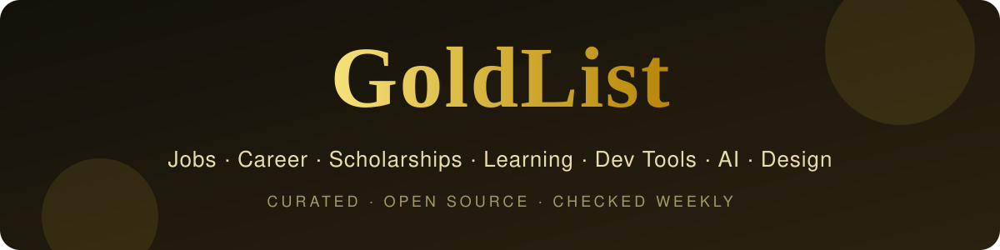
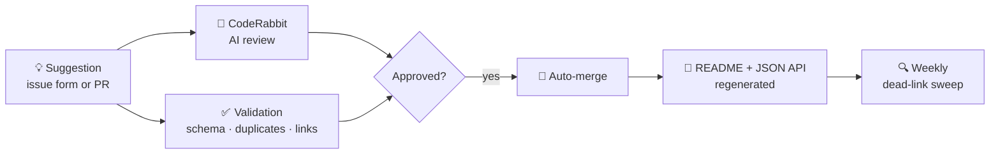

<a id="top"></a>

<div align="center">



<h3>Only the gold. Everything else is noise.</h3>

<p><b>196 hand-picked free &amp; open-source resources</b> for finding jobs, winning scholarships, learning,<br>
building, designing and staying safe, sorted into 14 categories and link-checked every week.</p>

[](#contents)
[](#gold-picks)
[](#contents)
<br>
[](https://github.com/UsmanGhias/goldlist/actions/workflows/links.yml)
[](https://github.com/UsmanGhias/goldlist/commits/main)
[](CONTRIBUTING.md)
[](#how-it-works)
[](LICENSE)

[💼 Jobs](#jobs) · [🧭 Career](#career) · [🎓 Scholarships](#scholarships) · [📚 Learning](#learning) · [🧑‍🎓 Students](#students) · [🛠️ Dev Tools](#dev-tools) · [🤖 AI Tools](#ai-tools) · [🧠 AI Coding](#ai-coding) · [🎨 Design](#design) · [🎬 Media](#media) · [⚡ Productivity](#productivity) · [🔬 Research](#research) · [🚀 Startups](#startups) · [🔒 Privacy](#privacy-security)

<sub>⭐ <b>Star this repo</b> to keep it one click away. New gold is added every week.</sub>

</div>

---

## Why GoldList?

You've bookmarked hundreds of "useful tools" and can't find any of them when you need one. Giant awesome-lists have **thousands** of links and no opinion. GoldList is the opposite:

<table>
<tr>
<td width="25%" valign="top"><b>🏆 Curated, not collected</b><br><sub>Every entry earns its place. Categories stay short, so you only see what's worth your time.</sub></td>
<td width="25%" valign="top"><b>🧭 One place for everything</b><br><sub>Jobs, scholarships, courses, dev tools, AI, design, media, research and privacy, all in one list.</sub></td>
<td width="25%" valign="top"><b>✅ Always alive</b><br><sub>A bot checks every link weekly. Every change is reviewed by AI and validated before it merges.</sub></td>
<td width="25%" valign="top"><b>🏷️ Honest labels</b><br><sub>Open source, fully free, or free tier, plus live GitHub stars, so you know exactly what you're getting.</sub></td>
</tr>
</table>

<a id="start-here"></a>

## 🎯 Start Here

| If you are… | Go straight to |
| :--- | :--- |
| 💼 **Hunting for a job** | [Jobs](#jobs) → [Career & Interviews](#career) → [AI Coding](#ai-coding) |
| 🎓 **A student** | [Students](#students) → [Scholarships](#scholarships) → [Learning](#learning) |
| 🌍 **Planning a funded master's or PhD** | [Scholarships](#scholarships) → [Research & Writing](#research) |
| 💻 **Learning to code** | [Learning](#learning) → [Dev Tools](#dev-tools) → [AI Coding](#ai-coding) |
| 🏗️ **Building a product** | [Dev Tools](#dev-tools) → [Startups](#startups) → [Design](#design) |
| 🤖 **Into AI** | [AI Tools](#ai-tools) → [AI Coding](#ai-coding) → [Learning](#learning) |
| 🎨 **A creator** | [Design](#design) → [Media](#media) → [Productivity](#productivity) |
| 🔐 **Privacy-conscious** | [Privacy & Security](#privacy-security) → [Productivity](#productivity) |

<a id="gold-picks"></a>

## 🏆 Gold Picks

The best of the best. If you only open a few links today, make it these.

<table>
<tr>
<td width="33%" valign="top">
 <b><a href="https://freehire.me">freehire</a></b><br>
<sub>IT job postings from many boards in one search, each linked back to the original posting.</sub><br>
<sub><a href="#jobs">💼 Jobs</a></sub>
</td>
<td width="33%" valign="top">
 <b><a href="https://news.ycombinator.com/submitted?id=whoishiring">Hacker News: Who is Hiring</a></b><br>
<sub>Monthly thread where startups post real openings, often remote and often from founders directly.</sub><br>
<sub><a href="#jobs">💼 Jobs</a></sub>
</td>
<td width="33%" valign="top">
 <b><a href="https://github.com/SimplifyJobs/Summer2027-Internships">Simplify Summer 2027 Internships</a></b><br>
<sub>Daily-updated list of tech internships in the US, Canada and remote.</sub><br>
<sub><a href="#jobs">💼 Jobs</a></sub>
</td>
</tr>
<tr>
<td width="33%" valign="top">
 <b><a href="https://www.techinterviewhandbook.org">Tech Interview Handbook</a></b><br>
<sub>Concise interview prep covering algorithm cheatsheets, behavioral questions and resume tips.</sub><br>
<sub><a href="#career">🧭 Career</a></sub>
</td>
<td width="33%" valign="top">
 <b><a href="https://github.com/donnemartin/system-design-primer">System Design Primer</a></b><br>
<sub>The classic guide to designing large-scale systems, with Anki flashcards.</sub><br>
<sub><a href="#career">🧭 Career</a></sub>
</td>
<td width="33%" valign="top">
 <b><a href="https://rxresu.me">Reactive Resume</a></b><br>
<sub>Open-source resume builder with no ads or tracking, exporting to PDF.</sub><br>
<sub><a href="#career">🧭 Career</a></sub>
</td>
</tr>
<tr>
<td width="33%" valign="top">
 <b><a href="https://www.eacea.ec.europa.eu/scholarships/erasmus-mundus-catalogue_en">Erasmus Mundus Catalogue</a></b><br>
<sub>Fully funded joint master's programmes taught across several European universities.</sub><br>
<sub><a href="#scholarships">🎓 Scholarships</a></sub>
</td>
<td width="33%" valign="top">
 <b><a href="https://www2.daad.de/deutschland/stipendium/datenbank/en/21148-scholarship-database/">DAAD Scholarship Database</a></b><br>
<sub>Search funding for studying or doing research in Germany.</sub><br>
<sub><a href="#scholarships">🎓 Scholarships</a></sub>
</td>
<td width="33%" valign="top">
 <b><a href="https://www.freecodecamp.org">freeCodeCamp</a></b><br>
<sub>Full-stack curriculum with free certifications and thousands of exercises.</sub><br>
<sub><a href="#learning">📚 Learning</a></sub>
</td>
</tr>
<tr>
<td width="33%" valign="top">
 <b><a href="https://cs50.harvard.edu/x/">CS50x</a></b><br>
<sub>Harvard's famous intro to computer science, free online.</sub><br>
<sub><a href="#learning">📚 Learning</a></sub>
</td>
<td width="33%" valign="top">
 <b><a href="https://roadmap.sh">roadmap.sh</a></b><br>
<sub>Step-by-step learning roadmaps for every developer role and technology.</sub><br>
<sub><a href="#learning">📚 Learning</a></sub>
</td>
<td width="33%" valign="top">
 <b><a href="https://education.github.com/pack">GitHub Student Developer Pack</a></b><br>
<sub>Free access to dozens of paid developer tools while you study.</sub><br>
<sub><a href="#students">🧑‍🎓 Students</a></sub>
</td>
</tr>
<tr>
<td width="33%" valign="top">
 <b><a href="https://summerofcode.withgoogle.com">Google Summer of Code</a></b><br>
<sub>Paid, mentored program for contributing to open-source projects.</sub><br>
<sub><a href="#students">🧑‍🎓 Students</a></sub>
</td>
<td width="33%" valign="top">
 <b><a href="https://github.com/ripienaar/free-for-dev">free-for-dev</a></b><br>
<sub>Hundreds of SaaS, PaaS and IaaS services with free tiers for developers.</sub><br>
<sub><a href="#dev-tools">🛠️ Dev Tools</a></sub>
</td>
<td width="33%" valign="top">
 <b><a href="https://github.com/public-apis/public-apis">public-apis</a></b><br>
<sub>Collective list of free APIs to build projects on.</sub><br>
<sub><a href="#dev-tools">🛠️ Dev Tools</a></sub>
</td>
</tr>
<tr>
<td width="33%" valign="top">
 <b><a href="https://supabase.com">Supabase</a></b><br>
<sub>Open-source Postgres backend with auth, storage and realtime, plus a free tier.</sub><br>
<sub><a href="#dev-tools">🛠️ Dev Tools</a></sub>
</td>
<td width="33%" valign="top">
 <b><a href="https://ollama.com">Ollama</a></b><br>
<sub>Run open LLMs locally with a single command.</sub><br>
<sub><a href="#ai-tools">🤖 AI Tools</a></sub>
</td>
<td width="33%" valign="top">
 <b><a href="https://aistudio.google.com">Google AI Studio</a></b><br>
<sub>Try Gemini models and get a free API key in minutes.</sub><br>
<sub><a href="#ai-tools">🤖 AI Tools</a></sub>
</td>
</tr>
<tr>
<td width="33%" valign="top">
 <b><a href="https://github.com/nextlevelbuilder/ui-ux-pro-max-skill">UI UX Pro Max Skill</a></b><br>
<sub>Design-intelligence skill that helps AI coding agents build polished, professional UI.</sub><br>
<sub><a href="#ai-coding">🧠 AI Coding</a></sub>
</td>
<td width="33%" valign="top">
 <b><a href="https://github.com/modelcontextprotocol/servers">MCP Servers</a></b><br>
<sub>Reference Model Context Protocol servers that connect AI agents to tools and data.</sub><br>
<sub><a href="#ai-coding">🧠 AI Coding</a></sub>
</td>
<td width="33%" valign="top">
 <b><a href="https://penpot.app">Penpot</a></b><br>
<sub>Open-source design and prototyping tool, an alternative to Figma.</sub><br>
<sub><a href="#design">🎨 Design</a></sub>
</td>
</tr>
<tr>
<td width="33%" valign="top">
 <b><a href="https://ui.shadcn.com">shadcn/ui</a></b><br>
<sub>Beautiful, accessible React components you copy into your project.</sub><br>
<sub><a href="#design">🎨 Design</a></sub>
</td>
<td width="33%" valign="top">
 <b><a href="https://www.blackmagicdesign.com/products/davinciresolve">DaVinci Resolve</a></b><br>
<sub>Hollywood-grade video editing and color grading, with a very capable free version.</sub><br>
<sub><a href="#media">🎬 Media</a></sub>
</td>
<td width="33%" valign="top">
 <b><a href="https://obsproject.com">OBS Studio</a></b><br>
<sub>Screen recording and live streaming.</sub><br>
<sub><a href="#media">🎬 Media</a></sub>
</td>
</tr>
<tr>
<td width="33%" valign="top">
 <b><a href="https://obsidian.md">Obsidian</a></b><br>
<sub>Local-first markdown notes with backlinks and a huge plugin ecosystem.</sub><br>
<sub><a href="#productivity">⚡ Productivity</a></sub>
</td>
<td width="33%" valign="top">
 <b><a href="https://localsend.org">LocalSend</a></b><br>
<sub>Share files between nearby devices with no internet or account.</sub><br>
<sub><a href="#productivity">⚡ Productivity</a></sub>
</td>
<td width="33%" valign="top">
 <b><a href="https://www.zotero.org">Zotero</a></b><br>
<sub>Collect, organize and cite research papers, with one-click capture from your browser.</sub><br>
<sub><a href="#research">🔬 Research</a></sub>
</td>
</tr>
<tr>
<td width="33%" valign="top">
 <b><a href="https://www.overleaf.com">Overleaf</a></b><br>
<sub>Collaborative LaTeX editor in the browser for papers and theses.</sub><br>
<sub><a href="#research">🔬 Research</a></sub>
</td>
<td width="33%" valign="top">
 <b><a href="https://www.startupschool.org">YC Startup School</a></b><br>
<sub>Y Combinator's free course on how to start a startup, plus co-founder matching.</sub><br>
<sub><a href="#startups">🚀 Startups</a></sub>
</td>
<td width="33%" valign="top">
 <b><a href="https://posthog.com">PostHog</a></b><br>
<sub>Open-source product analytics, session replay and feature flags with a big free tier.</sub><br>
<sub><a href="#startups">🚀 Startups</a></sub>
</td>
</tr>
<tr>
<td width="33%" valign="top">
 <b><a href="https://bitwarden.com">Bitwarden</a></b><br>
<sub>Open-source password manager with a free plan on every device.</sub><br>
<sub><a href="#privacy-security">🔒 Privacy</a></sub>
</td>
<td width="33%" valign="top">
 <b><a href="https://github.com/gorhill/uBlock">uBlock Origin</a></b><br>
<sub>Efficient, lightweight ad and tracker blocker.</sub><br>
<sub><a href="#privacy-security">🔒 Privacy</a></sub>
</td>
</tr>
</table>


<a id="contents"></a>

## 📑 Contents

| | Category | What's inside | Picks |
| :-: | :--- | :--- | :-: |
| 💼 | **[Jobs & Freelancing](#jobs)** | Where real openings get posted first, from remote boards to curated GitHub lists. | 15 |
| 🧭 | **[Career & Interviews](#career)** | Resumes, interview prep and salary data to land the offer and negotiate it. | 12 |
| 🎓 | **[Scholarships & Research Funding](#scholarships)** | Funded master's, PhDs and fellowships, so you can study without paying for it. | 15 |
| 📚 | **[Learning & Courses](#learning)** | Free courses and books that are as good as paid ones, often better. | 19 |
| 🧑‍🎓 | **[Students & Programs](#students)** | Free licenses, credits and paid programs available only while you're a student or newcomer. | 11 |
| 🛠️ | **[Developer Tools & Free Tiers](#dev-tools)** | Build, host and ship without a credit card. | 19 |
| 🤖 | **[AI Tools & Models](#ai-tools)** | Run models locally, build AI apps and automate your work. | 14 |
| 🧠 | **[AI Coding Agents & Skills](#ai-coding)** | Coding agents and the skills, servers and plugins that make them far better. | 9 |
| 🎨 | **[Design & UI](#design)** | Icons, fonts, photos and design tools that look premium and cost nothing. | 18 |
| 🎬 | **[Video, Audio & Media](#media)** | Studio-grade editing, recording and stock media at zero cost. | 12 |
| ⚡ | **[Productivity & Everyday Apps](#productivity)** | Notes, office apps and utilities, mostly open-source alternatives to paid apps. | 15 |
| 🔬 | **[Research & Writing](#research)** | Find papers, manage references and write better, for students and researchers. | 11 |
| 🚀 | **[Startups & Business](#startups)** | Launch and run a product, with free credits, analytics, CRM and support tools. | 10 |
| 🔒 | **[Privacy & Security](#privacy-security)** | Protect your accounts, data and devices, and learn security hands-on. | 16 |

**Legend:**  source code is public ·  free to use ·  generous free plan, paid upgrades · 🏆 gold pick

---

<a id="jobs"></a>

## 💼 Jobs & Freelancing

> Where real openings get posted first, from remote boards to curated GitHub lists.<br>
> <sub>15 picks · 3 gold</sub>

| | Resource | Why it's gold | Type | GitHub |
| :-: | :--- | :--- | :-- | :-- |
|  | **[freehire](https://freehire.me)** 🏆 | IT job postings from many boards in one search, each linked back to the original posting. |  |  |
|  | **[Hacker News: Who is Hiring](https://news.ycombinator.com/submitted?id=whoishiring)** 🏆 | Monthly thread where startups post real openings, often remote and often from founders directly. |  |  |
|  | **[Simplify Summer 2027 Internships](https://github.com/SimplifyJobs/Summer2027-Internships)** 🏆 | Daily-updated list of tech internships in the US, Canada and remote. |  | [](https://github.com/SimplifyJobs/Summer2027-Internships) |
|  | **[Simplify New Grad Positions](https://github.com/SimplifyJobs/New-Grad-Positions)** | Daily-updated list of new-grad software, data and engineering roles. |  | [](https://github.com/SimplifyJobs/New-Grad-Positions) |
|  | **[Work at a Startup](https://www.workatastartup.com)** | Y Combinator's job board, where one profile lets you apply to hundreds of YC startups. |  |  |
|  | **[remote-jobs](https://github.com/remoteintech/remote-jobs)** | Community-maintained list of remote-friendly tech companies, with regions and tech stacks. |  | [](https://github.com/remoteintech/remote-jobs) |
|  | **[Hiring Without Whiteboards](https://github.com/poteto/hiring-without-whiteboards)** | Companies that skip whiteboard puzzles and hire through practical take-homes and pairing. |  | [](https://github.com/poteto/hiring-without-whiteboards) |
|  | **[JobSpy](https://github.com/speedyapply/JobSpy)** | Python library that scrapes LinkedIn, Indeed, Glassdoor and more into one clean table. |  | [](https://github.com/speedyapply/JobSpy) |
|  | **[We Work Remotely](https://weworkremotely.com)** | One of the largest remote-only job boards, covering dev, design, support and more. |  |  |
|  | **[Remote OK](https://remoteok.com)** | Remote job board with salary ranges and tag-based filters. |  |  |
|  | **[Remotive](https://remotive.com)** | Curated remote tech jobs plus a job-alert newsletter. |  |  |
|  | **[Himalayas](https://himalayas.app)** | Remote job board with detailed company profiles and salary info, free for job seekers. |  |  |
|  | **[Wellfound](https://wellfound.com)** | Startup jobs (formerly AngelList Talent) with salary and equity shown upfront. |  |  |
|  | **[Contra](https://contra.com)** | Commission-free platform where freelancers get hired and paid. |  |  |
|  | **[Working Nomads](https://www.workingnomads.com)** | Curated remote jobs by category, delivered as an email digest. |  |  |

<p align="right"><a href="#top">↑ Back to top</a></p>

<a id="career"></a>

## 🧭 Career & Interviews

> Resumes, interview prep and salary data to land the offer and negotiate it.<br>
> <sub>12 picks · 3 gold</sub>

| | Resource | Why it's gold | Type | GitHub |
| :-: | :--- | :--- | :-- | :-- |
|  | **[Tech Interview Handbook](https://www.techinterviewhandbook.org)** 🏆 | Concise interview prep covering algorithm cheatsheets, behavioral questions and resume tips. |  | [](https://github.com/yangshun/tech-interview-handbook) |
|  | **[System Design Primer](https://github.com/donnemartin/system-design-primer)** 🏆 | The classic guide to designing large-scale systems, with Anki flashcards. |  | [](https://github.com/donnemartin/system-design-primer) |
|  | **[Reactive Resume](https://rxresu.me)** 🏆 | Open-source resume builder with no ads or tracking, exporting to PDF. |  | [](https://github.com/reactive-resume/reactive-resume) |
|  | **[Grind 75](https://www.techinterviewhandbook.org/grind75)** | Customizable week-by-week LeetCode study plan from the author of Blind 75. |  |  |
|  | **[Coding Interview University](https://github.com/jwasham/coding-interview-university)** | Multi-month self-study plan for becoming a software engineer. |  | [](https://github.com/jwasham/coding-interview-university) |
|  | **[NeetCode](https://neetcode.io)** | Structured LeetCode roadmap with free video explanations for every problem. |  |  |
|  | **[LeetCode](https://leetcode.com)** | The standard platform for practicing coding interview problems. |  |  |
|  | **[Resume Matcher](https://github.com/srbhr/Resume-Matcher)** | Compares your resume with a job description and suggests keywords to improve your match. |  | [](https://github.com/srbhr/Resume-Matcher) |
|  | **[JSON Resume](https://jsonresume.org)** | Open standard for writing your resume as JSON, with themes to render it. |  |  |
|  | **[Overleaf CV Templates](https://www.overleaf.com/latex/templates/tagged/cv)** | Professional LaTeX CV templates you can edit right in the browser. |  |  |
|  | **[Big-O Cheat Sheet](https://www.bigocheatsheet.com)** | Time and space complexity of common algorithms and data structures on one page. |  |  |
|  | **[Levels.fyi](https://www.levels.fyi)** | Crowdsourced compensation data by company, level and location. |  |  |

<p align="right"><a href="#top">↑ Back to top</a></p>

<a id="scholarships"></a>

## 🎓 Scholarships & Research Funding

> Funded master's, PhDs and fellowships, so you can study without paying for it.<br>
> <sub>15 picks · 2 gold</sub>

| | Resource | Why it's gold | Type | GitHub |
| :-: | :--- | :--- | :-- | :-- |
|  | **[Erasmus Mundus Catalogue](https://www.eacea.ec.europa.eu/scholarships/erasmus-mundus-catalogue_en)** 🏆 | Fully funded joint master's programmes taught across several European universities. |  |  |
|  | **[DAAD Scholarship Database](https://www2.daad.de/deutschland/stipendium/datenbank/en/21148-scholarship-database/)** 🏆 | Search funding for studying or doing research in Germany. |  |  |
|  | **[EURAXESS](https://euraxess.ec.europa.eu)** | EU portal for research jobs, PhD positions and fellowships. |  |  |
|  | **[FindAPhD](https://www.findaphd.com)** | Search funded PhD projects worldwide by subject and country. |  |  |
|  | **[Academic Positions](https://academicpositions.com)** | PhD, postdoc and faculty openings, mostly in Europe. |  |  |
|  | **[Marie Skłodowska-Curie Actions](https://marie-sklodowska-curie-actions.ec.europa.eu)** | EU funding for doctoral networks and postdoctoral fellowships. |  |  |
|  | **[ELLIS PhD & Postdoc Program](https://ellis.eu/phd-postdoc)** | Europe-wide machine learning PhD program with co-supervision across countries. |  |  |
|  | **[Google PhD Fellowship](https://research.google/programs-and-events/phd-fellowship/)** | Funding and Google mentorship for PhD students in computer science. |  |  |
|  | **[Fulbright Foreign Student Program](https://foreign.fulbrightonline.org)** | Funded graduate study in the United States for international students. |  |  |
|  | **[Chevening](https://www.chevening.org)** | UK government-funded one-year master's scholarships. |  |  |
|  | **[Commonwealth Scholarships](https://cscuk.fcdo.gov.uk)** | UK-funded master's and PhD scholarships for Commonwealth citizens. |  |  |
|  | **[Swedish Institute Scholarships](https://si.se/en/apply/scholarships/)** | Scholarships covering tuition and living costs for master's study in Sweden. |  |  |
|  | **[Stipendium Hungaricum](https://stipendiumhungaricum.hu)** | Hungarian government scholarships for bachelor's, master's and PhD study. |  |  |
|  | **[Türkiye Scholarships](https://www.turkiyeburslari.gov.tr)** | Turkish government scholarships covering tuition, housing and a monthly stipend. |  |  |
|  | **[Scholars4Dev](https://www.scholars4dev.com)** | International scholarships for students from developing countries. |  |  |

<p align="right"><a href="#top">↑ Back to top</a></p>

<a id="learning"></a>

## 📚 Learning & Courses

> Free courses and books that are as good as paid ones, often better.<br>
> <sub>19 picks · 3 gold</sub>

| | Resource | Why it's gold | Type | GitHub |
| :-: | :--- | :--- | :-- | :-- |
|  | **[freeCodeCamp](https://www.freecodecamp.org)** 🏆 | Full-stack curriculum with free certifications and thousands of exercises. |  | [](https://github.com/freeCodeCamp/freeCodeCamp) |
|  | **[CS50x](https://cs50.harvard.edu/x/)** 🏆 | Harvard's famous intro to computer science, free online. |  |  |
|  | **[roadmap.sh](https://roadmap.sh)** 🏆 | Step-by-step learning roadmaps for every developer role and technology. |  | [](https://github.com/nilbuild/developer-roadmap) |
|  | **[The Odin Project](https://www.theodinproject.com)** | Project-based full-stack web development path from zero to job-ready. |  | [](https://github.com/TheOdinProject/curriculum) |
|  | **[Full Stack Open](https://fullstackopen.com)** | University of Helsinki's modern web development course covering React, Node and GraphQL. |  |  |
|  | **[OSSU Computer Science](https://github.com/ossu/computer-science)** | A complete computer science degree path built from free online courses. |  | [](https://github.com/ossu/computer-science) |
|  | **[The Missing Semester](https://missing.csail.mit.edu)** | MIT's course on the tools nobody teaches, like the shell, Git, editors and debugging. |  | [](https://github.com/missing-semester/missing-semester) |
|  | **[build-your-own-x](https://github.com/codecrafters-io/build-your-own-x)** | Learn by rebuilding Git, Redis, Docker, databases and more from scratch. |  | [](https://github.com/codecrafters-io/build-your-own-x) |
|  | **[project-based-learning](https://github.com/practical-tutorials/project-based-learning)** | Curated project tutorials sorted by programming language. |  | [](https://github.com/practical-tutorials/project-based-learning) |
|  | **[Exercism](https://exercism.org)** | Coding exercises in 70+ languages with free human mentoring. |  |  |
|  | **[Learn Git Branching](https://learngitbranching.js.org)** | Interactive visual game that finally makes Git branching click. |  | [](https://github.com/pcottle/learnGitBranching) |
|  | **[MIT OpenCourseWare](https://ocw.mit.edu)** | Lecture notes, videos and exams from thousands of MIT courses. |  |  |
|  | **[free-programming-books](https://github.com/EbookFoundation/free-programming-books)** | Huge list of free programming books in many languages. |  | [](https://github.com/EbookFoundation/free-programming-books) |
|  | **[Neural Networks: Zero to Hero](https://karpathy.ai/zero-to-hero.html)** | Andrej Karpathy builds neural networks and GPT from scratch, step by step. |  |  |
|  | **[Practical Deep Learning (fast.ai)](https://course.fast.ai)** | Hands-on deep learning course for people who already code. |  |  |
|  | **[Hugging Face Learn](https://huggingface.co/learn)** | Free courses on LLMs, AI agents, diffusion models and more. |  |  |
|  | **[Google Machine Learning Crash Course](https://developers.google.com/machine-learning/crash-course)** | Fast-paced, practical intro to machine learning with interactive exercises. |  |  |
|  | **[Kaggle Learn](https://www.kaggle.com/learn)** | Short, hands-on micro-courses in Python, SQL, pandas and machine learning. |  |  |
|  | **[Khan Academy](https://www.khanacademy.org)** | Maths, science and computing lessons for every level. |  |  |

<p align="right"><a href="#top">↑ Back to top</a></p>

<a id="students"></a>

## 🧑‍🎓 Students & Programs

> Free licenses, credits and paid programs available only while you're a student or newcomer.<br>
> <sub>11 picks · 2 gold</sub>

| | Resource | Why it's gold | Type | GitHub |
| :-: | :--- | :--- | :-- | :-- |
|  | **[GitHub Student Developer Pack](https://education.github.com/pack)** 🏆 | Free access to dozens of paid developer tools while you study. |  |  |
|  | **[Google Summer of Code](https://summerofcode.withgoogle.com)** 🏆 | Paid, mentored program for contributing to open-source projects. |  |  |
|  | **[Outreachy](https://www.outreachy.org)** | Paid remote open-source internships for people underrepresented in tech. |  |  |
|  | **[LFX Mentorship](https://mentorship.lfx.linuxfoundation.org)** | Paid mentorships on Linux Foundation and CNCF open-source projects. |  |  |
|  | **[MLH Fellowship](https://fellowship.mlh.io)** | Remote fellowship programs in open source and software engineering. |  |  |
|  | **[MLH Hackathons](https://mlh.io)** | Student hackathons around the world, in person and online. |  |  |
|  | **[Devpost](https://devpost.com)** | Find online hackathons with real prizes and build your portfolio. |  |  |
|  | **[Hacktoberfest](https://hacktoberfest.com)** | Yearly October event that rewards your first open-source contributions. |  |  |
|  | **[JetBrains Educational Licenses](https://www.jetbrains.com/community/education/)** | Free JetBrains IDEs for students and teachers. |  |  |
|  | **[Azure for Students](https://azure.microsoft.com/en-us/free/students)** | Azure cloud credit for students, with no credit card required. |  |  |
|  | **[Figma for Education](https://www.figma.com/education/)** | Free Figma Education plan for students and educators. |  |  |

<p align="right"><a href="#top">↑ Back to top</a></p>

<a id="dev-tools"></a>

## 🛠️ Developer Tools & Free Tiers

> Build, host and ship without a credit card.<br>
> <sub>19 picks · 3 gold</sub>

| | Resource | Why it's gold | Type | GitHub |
| :-: | :--- | :--- | :-- | :-- |
|  | **[free-for-dev](https://github.com/ripienaar/free-for-dev)** 🏆 | Hundreds of SaaS, PaaS and IaaS services with free tiers for developers. |  | [](https://github.com/ripienaar/free-for-dev) |
|  | **[public-apis](https://github.com/public-apis/public-apis)** 🏆 | Collective list of free APIs to build projects on. |  | [](https://github.com/public-apis/public-apis) |
|  | **[VS Code](https://code.visualstudio.com)** | Free code editor with a huge extension ecosystem. |  |  |
|  | **[Zed](https://zed.dev)** | Very fast open-source code editor with built-in collaboration and AI. |  | [](https://github.com/zed-industries/zed) |
|  | **[Supabase](https://supabase.com)** 🏆 | Open-source Postgres backend with auth, storage and realtime, plus a free tier. |  | [](https://github.com/supabase/supabase) |
|  | **[Appwrite](https://appwrite.io)** | Open-source backend for web and mobile apps, self-hosted or in the cloud. |  | [](https://github.com/appwrite/appwrite) |
|  | **[Neon](https://neon.tech)** | Serverless Postgres with database branching and a free plan. |  |  |
|  | **[Cloudflare Pages](https://pages.cloudflare.com)** | Deploy static sites and frontends for free on a global CDN. |  |  |
|  | **[Vercel](https://vercel.com)** | Push-to-deploy hosting for frontends and Next.js, with a free Hobby plan. |  |  |
|  | **[Coolify](https://coolify.io)** | Self-hosted alternative to Heroku and Vercel for your own server. |  | [](https://github.com/coollabsio/coolify) |
|  | **[Hoppscotch](https://hoppscotch.io)** | Lightweight open-source API client, an alternative to Postman. |  | [](https://github.com/hoppscotch/hoppscotch) |
|  | **[Bruno](https://www.usebruno.com)** | Offline-first API client that stores collections as plain files in your Git repo. |  | [](https://github.com/usebruno/bruno) |
|  | **[DBeaver](https://dbeaver.io)** | Universal database client for Postgres, MySQL, SQLite and dozens more. |  | [](https://github.com/dbeaver/dbeaver) |
|  | **[Sentry](https://sentry.io)** | Error tracking and performance monitoring with a free developer plan. |  | [](https://github.com/getsentry/sentry) |
|  | **[DevDocs](https://devdocs.io)** | API documentation for hundreds of languages and frameworks, searchable and offline. |  | [](https://github.com/freeCodeCamp/devdocs) |
|  | **[regex101](https://regex101.com)** | Build, test and debug regular expressions with live explanations. |  |  |
|  | **[Let's Encrypt](https://letsencrypt.org)** | Free, automated HTTPS certificates for any website. |  |  |
|  | **[Oh My Zsh](https://ohmyz.sh)** | Framework that makes your terminal far more pleasant, with hundreds of plugins and themes. |  | [](https://github.com/ohmyzsh/ohmyzsh) |
|  | **[awesome-selfhosted](https://github.com/awesome-selfhosted/awesome-selfhosted)** | Free software you can host yourself, sorted by category. |  | [](https://github.com/awesome-selfhosted/awesome-selfhosted) |

<p align="right"><a href="#top">↑ Back to top</a></p>

<a id="ai-tools"></a>

## 🤖 AI Tools & Models

> Run models locally, build AI apps and automate your work.<br>
> <sub>14 picks · 2 gold</sub>

| | Resource | Why it's gold | Type | GitHub |
| :-: | :--- | :--- | :-- | :-- |
|  | **[Ollama](https://ollama.com)** 🏆 | Run open LLMs locally with a single command. |  | [](https://github.com/ollama/ollama) |
|  | **[Google AI Studio](https://aistudio.google.com)** 🏆 | Try Gemini models and get a free API key in minutes. |  |  |
|  | **[NotebookLM](https://notebooklm.google)** | Upload your sources and get grounded answers, summaries and audio overviews. |  |  |
|  | **[Open WebUI](https://github.com/open-webui/open-webui)** | Self-hosted ChatGPT-style interface for local and API models. |  | [](https://github.com/open-webui/open-webui) |
|  | **[LM Studio](https://lmstudio.ai)** | Desktop app to discover, download and chat with local LLMs. |  |  |
|  | **[llama.cpp](https://github.com/ggml-org/llama.cpp)** | Fast LLM inference in C/C++ that runs on almost any hardware. |  | [](https://github.com/ggml-org/llama.cpp) |
|  | **[vLLM](https://github.com/vllm-project/vllm)** | High-throughput engine for serving LLMs in production. |  | [](https://github.com/vllm-project/vllm) |
|  | **[Hugging Face](https://huggingface.co)** | Hub of open models, datasets and live demo apps. |  |  |
|  | **[Unsloth](https://github.com/unslothai/unsloth)** | Fine-tune open LLMs faster and with much less GPU memory. |  | [](https://github.com/unslothai/unsloth) |
|  | **[Dify](https://github.com/langgenius/dify)** | Visual platform for building LLM apps, RAG pipelines and agents. |  | [](https://github.com/langgenius/dify) |
|  | **[AnythingLLM](https://github.com/Mintplex-Labs/anything-llm)** | Private all-in-one app for chatting with your documents using any LLM. |  | [](https://github.com/Mintplex-Labs/anything-llm) |
|  | **[n8n](https://github.com/n8n-io/n8n)** | Fair-code workflow automation with AI agents, free to self-host as the Community Edition. |  | [](https://github.com/n8n-io/n8n) |
|  | **[ComfyUI](https://github.com/Comfy-Org/ComfyUI)** | Node-based interface for image and video generation models. |  | [](https://github.com/Comfy-Org/ComfyUI) |
|  | **[Whisper](https://github.com/openai/whisper)** | OpenAI's open-source multilingual speech-to-text model. |  | [](https://github.com/openai/whisper) |

<p align="right"><a href="#top">↑ Back to top</a></p>

<a id="ai-coding"></a>

## 🧠 AI Coding Agents & Skills

> Coding agents and the skills, servers and plugins that make them far better.<br>
> <sub>9 picks · 2 gold</sub>

| | Resource | Why it's gold | Type | GitHub |
| :-: | :--- | :--- | :-- | :-- |
|  | **[UI UX Pro Max Skill](https://github.com/nextlevelbuilder/ui-ux-pro-max-skill)** 🏆 | Design-intelligence skill that helps AI coding agents build polished, professional UI. |  | [](https://github.com/nextlevelbuilder/ui-ux-pro-max-skill) |
|  | **[MCP Servers](https://github.com/modelcontextprotocol/servers)** 🏆 | Reference Model Context Protocol servers that connect AI agents to tools and data. |  | [](https://github.com/modelcontextprotocol/servers) |
|  | **[Gemini CLI](https://github.com/google-gemini/gemini-cli)** | Google's open-source AI agent for the terminal, with a generous free tier. |  | [](https://github.com/google-gemini/gemini-cli) |
|  | **[Codex CLI](https://github.com/openai/codex)** | OpenAI's open-source coding agent that runs in your terminal. |  | [](https://github.com/openai/codex) |
|  | **[Aider](https://github.com/Aider-AI/aider)** | AI pair programming in your terminal that edits your Git repo directly. |  | [](https://github.com/Aider-AI/aider) |
|  | **[Continue](https://github.com/continuedev/continue)** | Open-source AI code assistant for VS Code and JetBrains, using any model. |  | [](https://github.com/continuedev/continue) |
|  | **[OpenHands](https://github.com/OpenHands/OpenHands)** | Open-source autonomous software engineering agent. |  | [](https://github.com/OpenHands/OpenHands) |
|  | **[Anthropic Agent Skills](https://github.com/anthropics/skills)** | Official example skills for Claude covering documents, design and development. |  | [](https://github.com/anthropics/skills) |
|  | **[awesome-agent-skills](https://github.com/VoltAgent/awesome-agent-skills)** | 1,000+ agent skills for Claude Code, Codex, Cursor and other agents. |  | [](https://github.com/VoltAgent/awesome-agent-skills) |

<p align="right"><a href="#top">↑ Back to top</a></p>

<a id="design"></a>

## 🎨 Design & UI

> Icons, fonts, photos and design tools that look premium and cost nothing.<br>
> <sub>18 picks · 2 gold</sub>

| | Resource | Why it's gold | Type | GitHub |
| :-: | :--- | :--- | :-- | :-- |
|  | **[Penpot](https://penpot.app)** 🏆 | Open-source design and prototyping tool, an alternative to Figma. |  | [](https://github.com/penpot/penpot) |
|  | **[shadcn/ui](https://ui.shadcn.com)** 🏆 | Beautiful, accessible React components you copy into your project. |  | [](https://github.com/shadcn-ui/ui) |
|  | **[Tailwind CSS](https://tailwindcss.com)** | Utility-first CSS framework for building any design without leaving your HTML. |  | [](https://github.com/tailwindlabs/tailwindcss) |
|  | **[Excalidraw](https://excalidraw.com)** | Hand-drawn style whiteboard for diagrams and sketches. |  | [](https://github.com/excalidraw/excalidraw) |
|  | **[Inkscape](https://inkscape.org)** | Professional vector graphics editor, an alternative to Illustrator. |  |  |
|  | **[GIMP](https://www.gimp.org)** | Powerful raster image editor, an alternative to Photoshop. |  |  |
|  | **[Krita](https://krita.org)** | Digital painting app made by artists, for artists. |  |  |
|  | **[Photopea](https://www.photopea.com)** | Photoshop-like image editor that runs in the browser. |  |  |
|  | **[Lucide](https://lucide.dev)** | Clean, consistent open-source icon set. |  | [](https://github.com/lucide-icons/lucide) |
|  | **[Heroicons](https://heroicons.com)** | Hand-crafted SVG icons from the makers of Tailwind CSS. |  | [](https://github.com/tailwindlabs/heroicons) |
|  | **[Phosphor Icons](https://phosphoricons.com)** | Flexible icon family with six weights, from thin to duotone. |  |  |
|  | **[Google Fonts](https://fonts.google.com)** | Large library of free, openly licensed fonts. |  |  |
|  | **[unDraw](https://undraw.co)** | Customizable illustrations with no attribution required. |  |  |
|  | **[Unsplash](https://unsplash.com)** | Free high-resolution photos for any project. |  |  |
|  | **[Coolors](https://coolors.co)** | Generate and explore color palettes in seconds. |  |  |
|  | **[Realtime Colors](https://www.realtimecolors.com)** | Preview your color palette and fonts on a real website layout instantly. |  |  |
|  | **[Haikei](https://haikei.app)** | Generate unique SVG waves, blobs and backgrounds for your designs. |  |  |
|  | **[Squoosh](https://squoosh.app)** | Compress and convert images in the browser while comparing quality side by side. |  | [](https://github.com/GoogleChromeLabs/squoosh) |

<p align="right"><a href="#top">↑ Back to top</a></p>

<a id="media"></a>

## 🎬 Video, Audio & Media

> Studio-grade editing, recording and stock media at zero cost.<br>
> <sub>12 picks · 2 gold</sub>

| | Resource | Why it's gold | Type | GitHub |
| :-: | :--- | :--- | :-- | :-- |
|  | **[DaVinci Resolve](https://www.blackmagicdesign.com/products/davinciresolve)** 🏆 | Hollywood-grade video editing and color grading, with a very capable free version. |  |  |
|  | **[OBS Studio](https://obsproject.com)** 🏆 | Screen recording and live streaming. |  | [](https://github.com/obsproject/obs-studio) |
|  | **[Kdenlive](https://kdenlive.org)** | Full-featured open-source video editor for Linux, Windows and macOS. |  |  |
|  | **[Shotcut](https://shotcut.org)** | Simple cross-platform video editor that supports hundreds of formats. |  | [](https://github.com/mltframework/shotcut) |
|  | **[Audacity](https://www.audacityteam.org)** | Record and edit audio, from podcasts to voice-overs. |  | [](https://github.com/audacity/audacity) |
|  | **[HandBrake](https://handbrake.fr)** | Convert and compress videos to any format. |  | [](https://github.com/HandBrake/HandBrake) |
|  | **[Blender](https://www.blender.org)** | Complete 3D suite for modeling, animation, rendering and video editing. |  |  |
|  | **[VLC](https://www.videolan.org/vlc/)** | Media player that plays practically any file. |  |  |
|  | **[yt-dlp](https://github.com/yt-dlp/yt-dlp)** | Command-line downloader for audio and video from thousands of sites. |  | [](https://github.com/yt-dlp/yt-dlp) |
|  | **[Canva](https://www.canva.com)** | Drag-and-drop design for social posts, slides and thumbnails, with a strong free plan. |  |  |
|  | **[Pexels](https://www.pexels.com)** | Free stock photos and videos you can use without attribution. |  |  |
|  | **[Freesound](https://freesound.org)** | Huge library of Creative Commons sound effects and samples. |  |  |

<p align="right"><a href="#top">↑ Back to top</a></p>

<a id="productivity"></a>

## ⚡ Productivity & Everyday Apps

> Notes, office apps and utilities, mostly open-source alternatives to paid apps.<br>
> <sub>15 picks · 2 gold</sub>

| | Resource | Why it's gold | Type | GitHub |
| :-: | :--- | :--- | :-- | :-- |
|  | **[Obsidian](https://obsidian.md)** 🏆 | Local-first markdown notes with backlinks and a huge plugin ecosystem. |  |  |
|  | **[LocalSend](https://localsend.org)** 🏆 | Share files between nearby devices with no internet or account. |  | [](https://github.com/localsend/localsend) |
|  | **[Logseq](https://logseq.com)** | Open-source outliner for notes, journals and knowledge graphs. |  | [](https://github.com/logseq/logseq) |
|  | **[Joplin](https://joplinapp.org)** | Open-source note app with end-to-end encrypted sync. |  | [](https://github.com/laurent22/joplin) |
|  | **[AppFlowy](https://appflowy.io)** | Open-source alternative to Notion that you can self-host. |  | [](https://github.com/AppFlowy-IO/AppFlowy) |
|  | **[Super Productivity](https://super-productivity.com)** | To-do list with time tracking, timeboxing and Jira/GitHub integration. |  | [](https://github.com/super-productivity/super-productivity) |
|  | **[LibreOffice](https://www.libreoffice.org)** | Full office suite for documents, spreadsheets and slides. |  |  |
|  | **[Thunderbird](https://www.thunderbird.net)** | Email, calendar and contacts in one open-source app. |  |  |
|  | **[Syncthing](https://syncthing.net)** | Sync folders between your devices privately, with no cloud in between. |  | [](https://github.com/syncthing/syncthing) |
|  | **[Espanso](https://espanso.org)** | Cross-platform text expander that saves you from typing the same things again. |  | [](https://github.com/espanso/espanso) |
|  | **[Flameshot](https://flameshot.org)** | Screenshot tool with instant annotation, arrows and blur. |  | [](https://github.com/flameshot-org/flameshot) |
|  | **[ShareX](https://getsharex.com)** | Windows power tool for screenshots, screen recording and instant sharing. |  | [](https://github.com/ShareX/ShareX) |
|  | **[Rectangle](https://rectangleapp.com)** | Snap and arrange macOS windows with keyboard shortcuts. |  | [](https://github.com/rxhanson/Rectangle) |
|  | **[PowerToys](https://github.com/microsoft/PowerToys)** | Microsoft's power-user utilities for Windows. |  | [](https://github.com/microsoft/PowerToys) |
|  | **[7-Zip](https://www.7-zip.org)** | File archiver with a high compression ratio that opens almost any archive. |  |  |

<p align="right"><a href="#top">↑ Back to top</a></p>

<a id="research"></a>

## 🔬 Research & Writing

> Find papers, manage references and write better, for students and researchers.<br>
> <sub>11 picks · 2 gold</sub>

| | Resource | Why it's gold | Type | GitHub |
| :-: | :--- | :--- | :-- | :-- |
|  | **[Zotero](https://www.zotero.org)** 🏆 | Collect, organize and cite research papers, with one-click capture from your browser. |  | [](https://github.com/zotero/zotero) |
|  | **[Overleaf](https://www.overleaf.com)** 🏆 | Collaborative LaTeX editor in the browser for papers and theses. |  |  |
|  | **[Typst](https://typst.app)** | Modern typesetting system that's much easier to learn than LaTeX. |  | [](https://github.com/typst/typst) |
|  | **[arXiv](https://arxiv.org)** | Open-access archive of preprints in CS, physics, maths and more. |  |  |
|  | **[Semantic Scholar](https://www.semanticscholar.org)** | AI-powered search engine for academic papers. |  |  |
|  | **[Google Scholar](https://scholar.google.com)** | Search scholarly literature and track citations. |  |  |
|  | **[Connected Papers](https://www.connectedpapers.com)** | Visual graph of papers related to the one you're reading. |  |  |
|  | **[Unpaywall](https://unpaywall.org)** | Find legal, free versions of paywalled research papers. |  |  |
|  | **[Elicit](https://elicit.com)** | AI research assistant that finds papers and extracts key findings. |  |  |
|  | **[LanguageTool](https://languagetool.org)** | Grammar and style checker for 30+ languages. |  | [](https://github.com/languagetool-org/languagetool) |
|  | **[Hemingway Editor](https://hemingwayapp.com)** | Highlights long, hard-to-read sentences so your writing gets clear and bold. |  |  |

<p align="right"><a href="#top">↑ Back to top</a></p>

<a id="startups"></a>

## 🚀 Startups & Business

> Launch and run a product, with free credits, analytics, CRM and support tools.<br>
> <sub>10 picks · 2 gold</sub>

| | Resource | Why it's gold | Type | GitHub |
| :-: | :--- | :--- | :-- | :-- |
|  | **[YC Startup School](https://www.startupschool.org)** 🏆 | Y Combinator's free course on how to start a startup, plus co-founder matching. |  |  |
|  | **[YC Library](https://www.ycombinator.com/library)** | Y Combinator's essays, videos and advice for founders. |  |  |
|  | **[AWS Activate](https://aws.amazon.com/activate/)** | AWS credits and support for early-stage startups. |  |  |
|  | **[Google for Startups Cloud Program](https://cloud.google.com/startup)** | Google Cloud credits and technical support for startups. |  |  |
|  | **[PostHog](https://posthog.com)** 🏆 | Open-source product analytics, session replay and feature flags with a big free tier. |  | [](https://github.com/PostHog/posthog) |
|  | **[Umami](https://umami.is)** | Simple, privacy-friendly website analytics, an alternative to Google Analytics. |  | [](https://github.com/umami-software/umami) |
|  | **[Listmonk](https://listmonk.app)** | Self-hosted newsletter and mailing list manager. |  | [](https://github.com/knadh/listmonk) |
|  | **[Chatwoot](https://www.chatwoot.com)** | Open-source customer support inbox for chat, email and social. |  | [](https://github.com/chatwoot/chatwoot) |
|  | **[Twenty](https://twenty.com)** | Modern open-source CRM, an alternative to Salesforce. |  | [](https://github.com/twentyhq/twenty) |
|  | **[Odoo Community](https://github.com/odoo/odoo)** | Open-source ERP covering CRM, sales, inventory, accounting and website. |  | [](https://github.com/odoo/odoo) |

<p align="right"><a href="#top">↑ Back to top</a></p>

<a id="privacy-security"></a>

## 🔒 Privacy & Security

> Protect your accounts, data and devices, and learn security hands-on.<br>
> <sub>16 picks · 2 gold</sub>

| | Resource | Why it's gold | Type | GitHub |
| :-: | :--- | :--- | :-- | :-- |
|  | **[Bitwarden](https://bitwarden.com)** 🏆 | Open-source password manager with a free plan on every device. |  | [](https://github.com/bitwarden/clients) |
|  | **[uBlock Origin](https://github.com/gorhill/uBlock)** 🏆 | Efficient, lightweight ad and tracker blocker. |  | [](https://github.com/gorhill/uBlock) |
|  | **[Firefox](https://www.mozilla.org/firefox/)** | Independent open-source browser with strong tracking protection. |  |  |
|  | **[Signal](https://signal.org)** | End-to-end encrypted messaging and calls. |  |  |
|  | **[KeePassXC](https://keepassxc.org)** | Offline open-source password manager. |  | [](https://github.com/keepassxreboot/keepassxc) |
|  | **[Ente Auth](https://ente.io/auth/)** | Open-source 2FA authenticator with end-to-end encrypted backups. |  | [](https://github.com/ente/ente) |
|  | **[Aegis Authenticator](https://getaegis.app)** | Secure open-source 2FA app for Android with encrypted backups. |  | [](https://github.com/beemdevelopment/Aegis) |
|  | **[VeraCrypt](https://www.veracrypt.fr)** | Encrypt whole drives or create encrypted containers for sensitive files. |  | [](https://github.com/veracrypt/VeraCrypt) |
|  | **[Tailscale](https://tailscale.com)** | Zero-config private network between your devices, free for personal use. |  |  |
|  | **[Proton Mail](https://proton.me/mail)** | Encrypted email with a free plan. |  |  |
|  | **[Have I Been Pwned](https://haveibeenpwned.com)** | Check whether your email address appeared in a data breach. |  |  |
|  | **[Privacy Guides](https://www.privacyguides.org)** | Independent, non-profit recommendations for privacy tools. |  |  |
|  | **[OWASP Top 10](https://owasp.org/www-project-top-ten/)** | The most critical web application security risks every developer should know. |  |  |
|  | **[TryHackMe](https://tryhackme.com)** | Learn cybersecurity through guided, hands-on labs in the browser. |  |  |
|  | **[OverTheWire Wargames](https://overthewire.org/wargames/)** | Learn Linux and security concepts through progressively harder games. |  |  |
|  | **[The Book of Secret Knowledge](https://github.com/trimstray/the-book-of-secret-knowledge)** | Huge collection of sysadmin, security and command-line cheatsheets. |  | [](https://github.com/trimstray/the-book-of-secret-knowledge) |

<p align="right"><a href="#top">↑ Back to top</a></p>

---

<a id="how-it-works"></a>

## ⚙️ How GoldList Stays Gold

Every change goes through the same automated pipeline, so the list stays accurate as it grows.



- **Single source of truth:** every entry lives in [`data/*.yaml`](data/). This README, the [JSON API](api/goldlist.json) and the suggestion form are all generated from it.
- **AI review:** [CodeRabbit](https://coderabbit.ai) reviews every pull request against the [quality bar](CONTRIBUTING.md#the-bar).
- **Strict validation:** CI rejects duplicates, broken links, missing fields and over-long descriptions.
- **Self-cleaning:** a weekly job checks every link and opens an issue if anything breaks.

### 📦 Use the data

Building an app, bot or website? Everything is available as JSON:

```bash
curl -s https://raw.githubusercontent.com/UsmanGhias/goldlist/main/api/goldlist.json
```

<a id="contributing"></a>

## 🤝 Contributing

Know something that deserves to be here?

- **30 seconds:** [suggest it with the form](https://github.com/UsmanGhias/goldlist/issues/new?template=suggest.yml). Once a maintainer labels it `accepted`, a bot adds it.
- **Pull request:** add it to [`data/`](data/) and open a PR. CodeRabbit reviews it and it merges automatically when approved. See [CONTRIBUTING.md](CONTRIBUTING.md).

The bar is high on purpose: **free or open source, actively maintained, and clearly the best (or close to it) at what it does.**

## 📈 Star History

<a href="https://star-history.com/#UsmanGhias/goldlist&Date">
  <picture>
    <source media="(prefers-color-scheme: dark)" srcset="https://api.star-history.com/svg?repos=UsmanGhias/goldlist&type=Date&theme=dark">
    
  </picture>
</a>

---

<div align="center">

**If GoldList saved you time, [give it a ⭐](https://github.com/UsmanGhias/goldlist) and share it with one friend who needs it.**

<sub>Released under [CC0 1.0](LICENSE): public domain, so copy it, share it, build on it.<br>
This README is generated from <code>data/*.yaml</code> by <code>scripts/build.py</code>. Edit the data, not this file.</sub>

<p><a href="#top">↑ Back to top</a></p>

</div>
